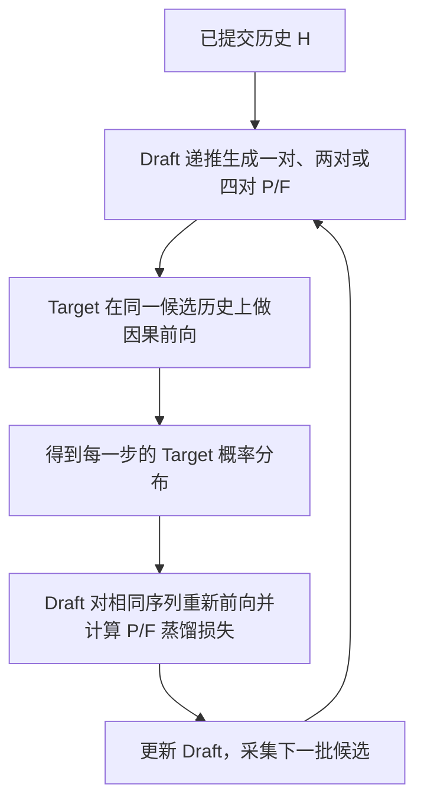

# GaussianGPT 联合 P/F 草稿训练计划

日期：2026-10-07（Asia/Shanghai）  
状态：S13a/b 训练和 S13b 真实联合 P/F 评测已完成；S14 方式已更新，尚未启动新训练。  
当前顺序：扩展已测低成本 P-only 路线 → 拒绝状态回放与接受率对齐蒸馏 → 再决定是否恢复联合 P/F 草稿。  
版本说明：第 1–16 节记录此前拟定的 A/B/C 方案；S13.2 的实测结果使其执行顺序发生变化，当前以第 17 节为准。

2026-10-08 当前任务：暂缓继续实验，完成阶段汇总。本计划保留为历史设计与后续建议；当前没有启动 S14 多场景评价、拒绝状态语料采集或训练。完整工作与结果范围见 [阶段工作汇报](STAGE_REPORT_2026-10-08.md)。

## 1. 目标与范围

训练一个能够低成本连续提出 `[P₁,F₁,P₂,F₂,P₃,F₃,P₄,F₄]` 的草稿，使 Target 一次验证后可以提交更长的有效前缀。P 表示位置 token，F 表示场景特征 token；网络隐藏状态另外称为 hidden state。

主要目标是提高完整生成路径的 tokens/s。训练损失、Feature overlap、连续接受长度均用于解释最终速度，不能单独替代端到端结果。约 3.67× 作为已有 Target 块计算的参考值，本文不承诺最终达到这一速度。

本轮文档确定以下边界：

- A/B/C 使用同一 Target、VQ-VAE、词表、序列化、3D RoPE 和输出分布；仅训练 Draft。
- 首轮保持 D8 的宽度和层数，先验证训练数据与目标是否有效。
- 使用联合 P/F 解码评价新草稿；已有 Position-only 路径保留为运行对照。
- 不改变 codebook，不加入按渲染相似度直接接受 token 的近似规则，不默认扩大到 D12。
- 不安装依赖、不改远端服务、不创建持续运行任务。本次交付仅写文档；实际训练另行执行。

## 2. 已有证据与待回答的问题

| 已有证据 | 能支持的判断 | 仍需确认 |
| --- | --- | --- |
| 1024-token 阶段测量：AR 两次前向合计 26.762 ms，Target 双 token 前向 16.844 ms | 合并计算存在可观的时间节省 | 新联合实现的草稿成本、拒绝成本与完整收益 |
| 256-step F-aware D8：Feature overlap 从 0.3876 提高到 0.7037；2048 token 时为 0.6107 | Feature 分布可以通过蒸馏改善 | 草稿自身前缀下的实际 F 接受率与连续八步表现 |
| 另一份短跑权重的真实联合测试：F 接受率 42.15%，pair 接受率 39.84%，速度为 AR 的 0.89–0.92 倍 | 旧联合草稿的质量和成本不足 | 更好的权重与训练方式能否改变结果 |
| 历史四对 Target 块摊销约 3.67× | 多位置共同计算值得继续研究 | 与普通 AR 对照的真实端到端速度 |

这些数据来自不同运行，不能拼成一次完整性能测量。特别是 Feature overlap 约 0.70 的权重，与上述 F 接受率约 0.42 的短跑权重不同。

历史块测试以四次单 pair 验证为参照。保存的测试脚本使用合成 token、短 KV 缓存，并按 `1+2K` 构造输入行；输入行还包含边界或额外预测所需的行。因此，四对候选、八个候选 token、Target 实际输入行数要分别记录。后续采用真实候选、真实前缀和实际生成循环重新测量，不能直接沿用旧倍率。

本计划回答四个问题：

1. 草稿自生成前缀训练是否改善第二至第四对的接受情况？
2. P/F 轻量分支能否提高 Feature 匹配，同时保持 Position 与运行效率？
3. 接受长度增加后，收益能否覆盖八步草稿生成及拒绝处理？
4. 如果独立 D8 仍太慢，是否值得转向 Target hidden state 辅助的轻量草稿？

证据来源见第 16 节。历史文档中针对 Position-only 路径的限制继续适用于该路径；本计划讨论同时提出 P/F 的新实验范围。

## 3. 核心方法与因果顺序

一次联合提议从已经提交的历史 H 开始，Draft 逐个采样候选。后一个候选以之前的草稿候选为条件，包含草稿提出的 Feature。



第 j 个训练位置比较：

```text
Target: p_j = P_T(next token | H, y_draft[0:j])
Draft:  q_j = Q_D(next token | H, y_draft[0:j])
Label:  对应下一个候选 y_draft[j] 所在的位置
```

`y_draft[0:j]` 不包含 `y_draft[j]`。例如训练 F₁ 时输入中可以包含 P₁；训练 P₁ 时不能读取 P₁ 或 F₁。候选序列中的离散采样不参与反向传播；训练时对固定候选序列重新执行带梯度的 Draft 前向。

具体实施要求：

- Target 处于推理模式，不累计梯度；Draft 的采样阶段关闭梯度，训练前向正常累计梯度。
- 第一版采样与训练均关闭 dropout，保持候选概率可复现；Target 的采样策略保持不变。
- 两个模型在同一预测位置使用相同的 token 类型限制、位置单调约束和坐标解释。
- 训练批量前向也要实现逐位置的合法 token mask。不能假设 `kv_cache=None` 时自动执行了推理路径中的全部限制。
- 修改候选后缀，不得影响更早位置的 logits 或 3D RoPE。通过因果性测试验证这一点。
- 连续提出 P/F 后，跨 pair 的依赖由草稿递推承担；Target 对相同历史验证。不能把“未来 Feature 尚未由 Target 采样”解释成联合提议在数学上不可实现。

## 4. A/B/C 三组实验

| 变体 | 初始化 | 监督前缀 | 模型结构 | 要回答的问题 |
| --- | --- | --- | --- | --- |
| A：继续蒸馏 | 同一较好的 F-aware D8 | Target 生成的候选历史 | 原 D8 | 更多有效训练与数据覆盖能带来多少改善 |
| B：自生成前缀 | 与 A 相同 | 50% Target 候选历史，50% 当前 Draft 候选历史 | 原 D8 | 部署前缀差异是否是后段接受率低的重要原因 |
| C：P/F 轻量分支 | 同一 D8 主干权重，新增分支初始为零贡献 | 与 B 相同的混合方式 | D8 + 两个类型专用残差分支 | 特征表示分工是否有额外价值 |

旧 canonical D8、旧较好 F-aware D8、当前可运行的 Position-only 路径仅作已有参照，不为这些对象重新启动一套训练。

公平比较约定：

- A/B/C 分别从相同初始权重开始。B 不接着 A 的最终权重训练；C 不接着 B 的最终权重训练。
- 使用相同的起始历史抽样顺序、上下文长度分布、监督位置数、优化步数、有效批量和采样参数；有效批量按实际 P/F 监督位置计数，具体见第 8 节。
- A 也采用相同的一对、两对、四对监督长度课程，仅候选历史来源不同。
- B/C 的候选由各自当前模型产生，内容允许不同；另用同一份验证前缀和公共候选集做诊断，不将这些验证数据用于更新模型。
- 相同步数不代表相同成本。分别记录 Target 标注、Draft rollout、训练前向与反向的时间、总 GPU 小时和峰值显存。
- 同时给出“相同监督预算”和“达到某个验证质量所需 GPU 小时”两种比较。

## 5. 数据与监督信息

### 5.1 来源和分组

优先复用已有 Target trajectory corpus、原始 scene/chunk 划分和 VQ-VAE token 数据。已有记录包含 32 条训练轨迹、4 条验证轨迹，但不能把轨迹数量当作独立场景数量。

每条样本记录普通可读信息：`scene_id`、`chunk_id`、`trajectory_id`、`split`、`source_seed`、`prefix_length`、`start_slot`、`draft_step`。仅记录来源中真实存在的字段，缺失时明确标注。

若已能访问独立场景，第一轮扩大数据的建议规模为训练 32 个场景、验证 8 个场景、测试 8 个场景，每个场景先采集 2 条轨迹；后续依据重复度和成本增加。此规模是初始建议，不能把现有轨迹改名后充当独立场景。

同一场景的不同 chunk 和轨迹不得分散到训练、验证、测试集合中。优先沿用原数据集划分；测试集只在模型与 K 选择结束后使用。

如果现有 runner 只支持从起始 token 无条件生成，先完成轨迹级实验，并将结论限制为该生成设置。跨场景结论需要在现有 runner 中增加真实 scene/prefix 输入支持，不能用不同 seed 代替独立场景。

### 5.2 上下文与起始位置

- 首轮训练从不超过 2048 token 的真实轨迹中抽样，覆盖 0–255、256–511、512–1023、1024–2047 四个前缀区间；按可用样本平衡抽样。
- 0–255 区间包含起始 token 的特殊情况，不将其延迟与稳态混为一项。
- 超过 2048 的上下文先作验证；若性能明显下降，再把长前缀加入后续训练，单独记录这一变化。
- 覆盖从 Position 开始和从 Feature 开始的合法前缀。后者会在 Position 重新采样或额外提交之后出现。
- 一条训练样本通常监督至多 2/4/8 个候选位置。到 EOS 或长度上限即结束，实际有效位置数用于计算监督预算。

### 5.3 在线候选与存储

此处“在线”表示训练过程中采样，与后台持续运行无关。B/C 每次更新从当前 Draft 产生新候选；同一个有效批量内参数不变。Target 在这些相同候选前缀上提供软分布，第一版不使用跨多次更新的陈旧候选池。

真实线上拒绝之后不会继续提交原候选后缀。训练仍可使用合法的完整草稿后缀学习条件分布，但要分别记录拒绝前与拒绝后位置的诊断结果；后者的 overlap 不能写成实际接受率。

全词表 logits 仅在当前批量中按位置分块计算并释放，默认不长期保存。持久保存 token、样本来源和汇总统计；复用一份公共数据集，避免为 A/B/C 各复制一份。

## 6. 损失函数与概率口径

### 6.1 首轮损失

在相同合法 token 集合上，以 temperature=0.9 计算未经 top-p 截断的 Target 与 Draft 软分布，分别求 Position 和 Feature 的平均 KL：

```text
L_P = mean_j_in_P KL(p_teacher_soft[j] || q_draft_soft[j])
L_F = mean_j_in_F KL(p_teacher_soft[j] || q_draft_soft[j])
L   = lambda_P * L_P + lambda_F * L_F
```

默认 `lambda_P=1`、`lambda_F=2`，先让 Feature 获得更大的训练权重。这是待验证起点，与旧训练中采用其他损失定义的系数不能直接比较。损失以整个优化步的 P/F 有效位置数归一化；累积梯度时先求各 microbatch 的损失总和，再除以整个优化步对应类型的目标位置数，不能把长短 microbatch 的平均损失等权相加。正式更新前补足第 8 节定义的类型配额；单个 microbatch 某类为空时跳过该项。

先对旧权重做零步评价，再开始训练。若短跑中 Position 明显退化且总连续接受长度没有改善，比较 `lambda_F=1` 的一个短对照；选定后 A/B/C 使用相同系数，不展开大规模系数组合。首轮不同时加入新的渲染损失、隐藏状态损失或强化学习目标。

### 6.2 top-p 与数值处理

- KL 在共同合法词表的软分布上计算，不把各自 top-p 截断后出现的零概率直接代入 KL。
- 使用 float32 的 `log_softmax`/概率运算和有效 token mask；合法集合之外的位置不参与损失。
- 若合法集合为空或出现非有限值，保留该样本信息并停止当前错误批次，修复原因后继续。
- 部署评价使用实际 `temperature=0.9`、`top_p=0.9`、不启用 top-k 的最终概率分布。训练 soft KL 与部署 overlap 分开记录。
- Draft 与 Target 在候选生成、接受计算中使用的实际概率必须准确保存或重算，不能用训练软分布替代部署概率。

### 6.3 后续可选损失

只有 B 显示稳定收益后，再单独比较直接优化分布重合度的辅助项：

```text
overlap(p, q) = sum_v min(p[v], q[v])
L_overlap = 1 - overlap(p, q)
```

该项先在共同合法集合的软分布上作为可求导近似，部署 top-p 后的真实 overlap 用于评价。它不自动代表连续八步的联合接受概率；不把八个边际平均 overlap 相乘当作实测结果。

## 7. C 组的最小结构变化

保留 D8 的 8 层、512 宽主干和原输出权重。在最终 hidden state 与输出层之间，按“下一步预测的 token 类型”选择一个轻量残差分支：

```text
h_P = h + U_P activation(D_P h)
h_F = h + U_F activation(D_F h)
```

首轮采用宽度 64 的中间层；两组矩阵合计新增约 131,072 个参数，不计偏置。`U_P/U_F` 从零开始，使初始 logits 与同起点 D8 一致。Position 分支沿用原 Position 与 EOS 输出行，Feature 分支沿用原 Feature 输出行，不复制整个大词表输出层。

每一步只运行所需分支。第一版各分支均训练，主干也参与更新。用一次初始化数值比较确认新增结构没有改变起点分布；加载新权重时必须记录分支结构，不能静默忽略新增参数。

这两个分支用于区分预测任务，不会一次独立预测全部八个候选。生成 F₁ 仍需输入本轮 P₁，生成 P₂ 仍需输入本轮 F₁。已有 shadow 路径在 P/F 提交后复用 q_F 的做法，不能作为提前提出 Feature 的免费计算。

## 8. 首轮训练配置与有限预算

以下是实施起点，尚未测得收敛时间。启动真实训练前，从远端现有脚本读取其优化器与数据接口；若接口名称不同，修改实际配置映射，不凭本文拼出不存在的命令。

| 项目 | 建议值或规则 |
| --- | --- |
| Target / VQ-VAE | 保持现有权重不变，关闭梯度 |
| Draft 初始化 | 已记录的较好 256-step F-aware D8；实际文件可读且配置匹配后复用 |
| 优化器 | 沿用现有训练实现；若原配置不可获得，采用 AdamW 起点并明确记录 |
| 初始学习率 | `1e-5`，前 50 次更新线性增加至该值，之后余弦下降至 `1e-6` |
| AdamW 起点参数 | `betas=(0.9,0.95)`，`eps=1e-8`，`weight_decay=0.01`；参数分组沿用现有实现 |
| 梯度裁剪 | 范数 1.0 |
| 计算精度 | 复用远端已可运行的 bf16 设置；损失概率运算使用 float32 |
| 有效批量 | 每次更新 64 个有效监督位置，其中 P=32、F=32；microbatch 从 1 个前缀开始，实际前缀数随 EOS 和候选长度变化 |
| 首轮训练 seed | 0；明确赢家后，A 和赢家再比较 seed 1、2 |
| 更新次数 | 每个变体最多 2048 次；先运行前 128 次确认实际学习行为 |
| 轻量验证 | 每 128 次更新，使用同一组验证前缀 |
| 小规模端到端评价 | 第 512、1024、2048 次更新，或提前停止时 |
| 保存权重 | 每个运行复用 `last.ckpt` 和按验证标准选出的 `best.ckpt`；不额外复制同一内容 |

课程按累计有效监督位置推进。由于每次更新固定使用 64 个有效位置，下表的更新范围与监督预算严格对应；长度比例也按有效监督位置计数：

| 更新范围 | 累计有效位置范围 | 监督长度分布 | 目的 |
| --- | --- | --- | --- |
| 1–512 | 1–32,768 | 100% 一对 | 先改善第一组条件分布 |
| 513–1024 | 32,769–65,536 | 50% 一对、50% 两对 | 学习第一次草稿 Feature 之后的后续预测 |
| 1025–2048 | 65,537–131,072 | 25% 一对、25% 两对、50% 四对 | 扩展连续深度，同时保留短前缀能力 |

A/B/C 使用同一课程。每步的 32 个 P 和 32 个 F 各自满足该阶段的长度比例；B/C 再在每个类型与长度组中按有效位置实现 Target/Draft 来源各 50%，A 全部使用 Target 来源。例如最后阶段每个类型的一对、两对、四对配额为 8、8、16，B/C 将每项等分到两个来源。这些分组是普通批量采样计数，不需要额外的数据管理系统。

EOS 之后不产生监督位置。某个配额不足时，从同一类型、来源和长度组继续抽取新前缀；超出配额的最后一段只让所需位置进入该步损失，不改变其因果输入。记录实际处理的前缀数、未进入损失的位置数和补采成本；若有效样本不足，报告数据问题，不能无限补采或把缺失位置算作有效样本。不同变体的前缀数可以不同，公平比较的主预算为有效监督位置与优化更新，同时报告真实用时。

初始 128 次更新包含在正式预算内。若训练配置未变化，直接继续已有运行；只有改变模型或训练条件时才另记一个实验。记录前 128 次真实用时后再估算剩余 GPU 小时，不预先承诺完成日期。

## 9. 联合解码与最少必要验证

优先复用已有 `StructuredSpeculativeEngine` 和 benchmark 入口。对同一已提交前缀，Draft 逐个生成候选，Target 一次给出各位置 logits，然后从第一个候选开始顺序执行接受判定。

对于候选 y，使用同一历史下的实际部署概率：

```text
accept_prob = min(1, p(y) / q(y))
若拒绝：从 normalize(max(p - q, 0)) 采样，舍弃其后的候选
若候选全部接受且未结束：可使用额外预测行提交一个 Target token
```

EOS 是正常输出事件。首次拒绝之后的候选不参与实际接受率计数，其坐标、token 元数据和 KV 状态均不得继续沿用。不要人为让测试“全部接受”来宣称输出分布不变。

随新训练和推理改动执行以下普通测试，复用已有效的旧结果，仅为改变的路径补测：

| 测试 | 输入与验证内容 |
| --- | --- |
| 行对齐与因果性 | 短序列逐 token 与整段前向比较；改变后缀后，之前 logits 保持数值一致 |
| P/F 与坐标限制 | 两种起始类型、不同合法位置、EOS；训练和推理产生相同合法集合 |
| KL 与梯度 | 合法集合中概率有限、损失可求导、Target 无梯度、Draft 有有效梯度 |
| 联合接受数学 | 小词表枚举或 Monte Carlo，覆盖 P 拒绝、F 拒绝、连续接受、零概率与 EOS |
| KV 与位置状态 | 每次提交后与该真实前缀重新前向比较，覆盖一对、两对、四对及长度截断 |
| 最小真实训练 | 128 次更新内记录损失、梯度、验证指标和实际用时，确认训练真正执行 |
| 生成与重建 | 同一评估设置下生成并解码，记录异常、场景结构及已有渲染指标 |

精确分布保持来自接受与拒绝采样算法及正确实现；有限样本实验只提供统计证据。渲染相似不能替代概率或状态验证。普通 AR 和联合路径使用相同 seed 也可能消耗不同数量的随机数，不要求逐 token 输出相同。

## 10. 评价指标：先说明分母

对每一轮 r，记录候选数 `n_r`、连续接受候选数 `a_r`、实际提交数 `c_r`、起始类型、结束原因和耗时。候选数最多八个；从 Feature 开始、EOS 或长度上限均可能使实际数量更少。

| 指标 | 定义和用途 |
| --- | --- |
| 平均连续接受长度 | `sum(a_r) / rounds`，只数 Draft 候选，不含拒绝后重新采样或额外提交 |
| 平均提交长度 | `sum(c_r) / rounds`，包含实际进入输出的全部 token，直接关联吞吐 |
| P/F 实际接受率 | 按类型分别用“接受数 / 实际被验证数”；首次拒绝后的后缀不进入分母 |
| P/F overlap | 在相同前缀上比较最终部署分布；区分公共前缀诊断与真实运行中被访问的前缀 |
| 深度条件接受率 | 第 k 个候选被接受的轮数 / 实际验证到第 k 个候选的轮数；必须同时报告到达数 |
| 总体接受深度曲线 | 对共同的起始轮次集合，计算 `a_r>=k` 的比例；提前结束的轮次保留在分母中，EOS 终止和拒绝分别统计 |
| 总体继续率 | 同一集合中，前 k 个候选均接受且其中没有 EOS 的比例，表示还能继续生成的轮次比例 |
| 八候选全通过率 | `a_r=n_r=8` 的轮数除以 `n_r=8` 的轮数，同时报告这类轮占总轮数的比例，以及第八个候选为 EOS 的比例 |
| 草稿成本 | 整轮候选生成时间，以及每个实际提交 token 分摊的草稿时间 |
| 验证效率 | 每 1000 个实际输出 token 的 Target 调用数与实际输入行数 |
| 吞吐 | 实际输出 token 总数 / 总生成时间；同时记录 EOS 是否计入，所有方法保持一致 |

四对的总体曲线使用开始时从 P 预测、且剩余输出额度至少为八个 token 的全部轮次作为固定分母；不能只保留实际生成满八个候选的长轮。记录每个深度的首次拒绝数、提交 EOS 数和实际到达数。提前 EOS 会降低更深位置的总体继续率，但应归因于自然结束，不能记为拒绝。

从 F 开始的轮次单独报告，并按引擎实际候选预算给出可达到的最大深度，不强行补成八个候选。长度上限不足八个 token 的尾轮另报，仍计入完整吞吐。八候选全通过率是对完整候选组的条件统计，需要与上述总体曲线一起解释；若第八个候选为 EOS 且被接受，可以计作八候选全通过，同时归入终止轮，不能计作仍可继续的轮次。

完整成本定义：

```text
生成吞吐 = sum(实际提交 token) / sum(完整生成耗时)
生成耗时包含：前缀处理、Draft、Target 验证、采样、拒绝处理、缓存操作与调度
```

模型加载和数据读取另记；首轮 KV 分配和前缀处理计入完整生成时间。另给稳态增量解码时间，用于解释长前缀影响。VQ-VAE 解码和渲染不计入 AR 吞吐，但完整场景生成报告要单独列出它们及总耗时。

不要将有嵌套或同步重叠的分项直接相加。CUDA 阶段计时用于诊断；正式端到端计时只在完整区间边界同步，避免逐算子同步改变真实运行方式。

## 11. 评估矩阵与模型选择

### 11.1 分层执行，控制总实验量

1. 零步评价旧权重，建立同一 runner 下的当前对照；已有结果仅在代码、配置和计时范围一致时复用。
2. 训练中的轻量验证使用相同的 16 个前缀，按类型和上下文长度覆盖；有场景信息时至少来自 4 个验证场景。
3. 第 512、1024、2048 次更新，以 4 个公共前缀、1024 输出上限、seed 5、K=1/2/4 做小型速度比较。每次包含同配置普通 AR，性能计时与详细状态诊断分开运行。
4. A/B/C 各自只选一份候选权重进入完整验证。使用 8 个验证前缀、输出上限 256/1024/2048/4096、生成 seed 5/6/7；先以 4 个前缀筛选 K，再对每个变体选出的一个 K 完成矩阵，每个配置重复 3 次。
5. 只有出现值得继续的赢家，才对 A 与赢家补训练 seed 1、2，并用同一评价流程确认。
6. 最终模型和 K 选定后，运行未参与选择的测试场景，报告与普通 AR、现有最佳可运行路径的比较。

表中的前缀数是首轮数量上限，来源不足时使用真实数量并缩小结论范围。K 的筛选消耗和所有试验次数均记录，不能只展示赢家。

### 11.2 公平计时与统计

- 使用同一台空闲 GPU、相同软件栈、精度、编译设置和输出上限；不同时运行竞争 GPU 的其他实验。
- 显式设置 warmup=128 token，各变体均预热；运行顺序交替或随机，降低温度与缓存顺序影响。
- Target 的 temperature=0.9、top-p=0.9、top-k 关闭，原始 token 合法性和 EOS 策略保持一致。
- 自然 EOS 为主要设置。逐例报告实际输出长度、耗时和终止原因，并比较长度分布；不同长度的总耗时不能直接作为同工作量加速。
- 需要相同工作量诊断时，优先复用公共真实轨迹的 teacher-forcing 测量；如增加禁用 EOS 的固定长度诊断，AR 与联合路径都使用同一修改，并把结论限制在该诊断分布，不能代替自然生成结果。
- 报告每个前缀与 seed 的速度比、总 token/总时间、均值、中位数和波动范围。跨场景置信区间以场景为重采样单位；没有场景标识时以轨迹为单位并说明限制。
- 不将循环内数千个 token 视为数千个独立实验样本；重复运行先在同一配置内汇总。

### 11.3 选择与停止

优先按验证集完整吞吐选择权重。轻量 KL/overlap 仅用于训练诊断，不因为它们更好就覆盖一个更快的权重。

- B 相对 A 的连续接受长度和完整吞吐均提高，且在补充 seed 后仍成立：继续自生成前缀训练。
- C 相对 B 只改善 Feature 指标，完整吞吐没有收益：保留 B，不扩大专用分支。
- 连续接受长度提高，但独立 D8 的提议成本仍抵消收益：停止扩大 D8 容量，评估第 13 节的轻量结构。
- 损失下降而连续接受长度不升：先核对训练/部署概率、前缀来源和数据覆盖，不直接增加训练步数。
- 连续三次轻量验证都无改善，且最近一次端到端评价没有收益：允许提前结束该变体，保留已产生的结果。
- 无法区分收益与运行波动时，结论写为尚不明确；先增加有限重复，不宣称已达到 3×。
- 若接受算法或 KV 状态出现错误，停止该错误路径，定位原因并重新验证，不用高吞吐掩盖输出问题。

## 12. 实施阶段、职责与交付

| 阶段 | 输入 | 实际工作 | 产出与结束位置 |
| --- | --- | --- | --- |
| 0：复用运行对象 | 已有远端工程、脚本、权重与数据 | 按实际影响范围执行一次本机 Revive，确认主工程、Git 改动、GPU 进程、数据和产物位置 | 记录真实路径及可复用状态；不重建第二套工程 |
| 1：最小数据与训练实现 | 已有 S3 训练入口、P/F 模型和联合引擎 | 加入同前缀软监督、两种前缀来源及课程配置；补因果性与数值测试，同时运行短训练 | 128 次真实更新及诊断；配置不变即可继续 |
| 2：A/B 训练 | 同一 D8 起点、同一训练预算 | 完成 A/B，并进行一对、两对、四对评价 | 得到训练方式的对照结果，决定是否继续 |
| 3：C 结构对照 | 同一 D8 起点及 B 的训练方式 | 加入类型专用残差分支，运行同预算训练 | 得到新增参数、接受长度和吞吐结果 |
| 4：最终评价 | 三组各自选出的权重 | 执行完整验证、必要的训练 seed 重复、未见场景测试 | 一份明确的模型选择与失败原因记录 |
| 5：结果归档 | 配置、权重、计时与测试结论 | 更新实验和架构文档，刷新状态快照；只处理本次明确产生且已无用途的临时对象 | 用户可复现的结果及剩余限制 |

主 Agent 负责范围、损失与因果设计、远端变更、结果整合。子 Agent 可分别负责训练入口、模型分支、独立验证；最多三名并行，写入范围不重叠，共享文件由主 Agent 协调。优先复用已有 Agent，以 `gpt-6-luna` 和 `max` 为默认设置。

阶段 0 属于此前 A/B/C 方案的实施要求。S13.2 已通过远端工程完成真实联合 P/F 评测；S14 开始前仍需确认多场景数据划分、GPU support mapping 成本与 D8 权重位置。状态页按本机工作区生成，远端权重和运行数据不在本地索引中。

## 13. 备选方向：Target hidden state 辅助的轻量草稿

当独立 D8 的八步提议成本过高时，考虑用 Target 对已提交历史的 hidden state 初始化一个轻量递推模型，再依次消费草稿候选 P/F。可参考 EAGLE 类方法的状态复用思路，具体结构仍需独立验证。

边界要求：

- 只读取已提交、且已由 Target 处理过的位置状态。若最后一个已提交 token 尚待 Target 消费，由草稿显式处理，不能假定该位置的 Target 状态已经存在。
- 未来候选状态由草稿递推；训练也模拟同一信息可用顺序。
- 拒绝之后，只保留有效前缀对应的状态；不同候选路径的 3D 坐标与状态不能混用。
- 现有模型主要返回 logits，需要新增 hidden state 输出及相应状态管理。本计划不把该能力写成已经实现。
- 单独记录状态获取、保存、类型分支与递推成本；同样用完整 tokens/s 决定是否有价值。

该方向不与首轮 A/B/C 同时展开，不承诺单纯依靠继续训练就能越过独立 D8 的成本限制。

## 14. 实施对象与产物位置

本地文档主目录为 `/Users/lief/Documents/ChatGPT/GaussianGPT`。历史记录中的运行工程为 `/root/workspace/GaussianGPT`；实际实施前确认这个远端目录仍是主工程。`.codex/remote-source/` 是本地保存的源码参考，不能用它的存在推断远端运行版本。

| 对象 | 已有位置或拟使用位置 | 处理原则 |
| --- | --- | --- |
| Target 权重 | 远端 `checkpoints/gpt_vfront.ckpt` | 复用，不训练 |
| VQ-VAE 权重 | 远端 `checkpoints/vqvae_vfront.ckpt` | 复用，不训练 |
| S14 主要 Draft 起点 | canonical D8：`profiling/s2/d8_canonical_38ep/logs/s2_d8_canonical_38ep/lightning_logs/version_0/checkpoints/val_loss_monitor_epoch_37_step_50502.ckpt`；S13b 权重作为比较项 | 启动前确认远端文件与配置；S13b 实测未显示联合吞吐收益，暂不作为默认起点 |
| 已用训练入口 | 远端 `profiling/s13_draft_prefix/s13_draft_prefix_train.py`，S13 训练使用过 | 先阅读实际参数、数据接口和保存逻辑，再决定扩展方式 |
| Draft 模型参考 | `.codex/remote-source/model/gpt/nanochat_gpt.py` | 远端对应源码才是未来运行修改对象 |
| 已测联合引擎 | 远端 `model/gpt/joint_feature_speculative.py::generate_joint_feature` | S13.2 实测使用；之后联合 P/F 对照沿用并记录源码版本 |
| 已测联合 runner | 远端 `profiling/s13_draft_prefix/e2e/run_joint_s13b_seed{0,1,2}.py` | 每个 seed 使用独立输出文件，避免覆盖 S7 历史结果 |
| S13 配置与数据参考 | 远端 `profiling/s13_draft_prefix/run_candidate_rollout_fkl06_512step/run_config.json` 和 `draft_trajectory_corpus.pt` | 只作来源与格式参考；S14 需增加 `D_reject` 并另存配置 |
| 拟用 S14 产物目录 | `/root/workspace/GaussianGPT/profiling/s14_acceptance_draft/` | 尚未创建；候选权重、配置、语料和逐 seed 结果分开保存 |

产物应包括：实际运行配置、数据来源清单、训练曲线、所选权重、每轮接受记录的必要汇总、逐配置性能结果与最终分析。复用已有记录机制，不新增内容摘要校验方案，也不删除已有安全功能。

大权重、渲染结果和性能产物不提交到本地文档仓库。不得清理用户已有源码、凭据、历史权重或运行数据。只在用途确认后处理本实验自己产生的临时张量文件，保留最终结果及可复现信息；不设置定期清理任务。

未来实际修改代码、权重或性能结果后，按项目规则运行 `.codex/scripts/update_status.py`，并把稳定结论写入 `EXPERIMENTS.md`；结构变化写入 `ARCHITECTURE.md`。本计划保持为方案记录，结果文档记录事实，两者不相互替代。

## 15. 开始实施时需要确认的事实

这些事项不影响本次文档交付，但影响真实运行：

1. 远端连接、空闲 GPU、主工程与已有修改的实际状态。
2. 推荐 Draft 起点和 corpus 是否仍可读取，训练配置能否恢复。
3. 数据是否带可靠的 scene/chunk 标识；原划分是否可复用。
4. 联合 runner 是否已支持真实前缀输入、F 起始轮次和逐轮统计。
5. 前 128 次训练的实际用时与显存，以此决定后续 GPU 时间预算。

若某项不可用，先使用安全且范围明确的替代路径，并在结果中缩小相应结论；涉及新增付费资源、替换 Target 或改变研究范围时再向用户确认。

## 16. 证据与参考入口

- [实验记录](EXPERIMENTS.md)：阶段计时、较好 F-aware 权重、联合 P/F 原型、四对块计算和已有运行对照。
- [草稿方法历史](DRAFT_METHODS_HISTORY.md)：已测试方法及其效果边界。
- [架构说明](ARCHITECTURE.md)：P/F 序列、3D RoPE、现有 proposer 与缓存规则。
- [研究方案](RESEARCH_SOLUTIONS.md)：已有蒸馏、分支和轻量草稿研究线索；本计划是用户新同意方向的具体实施版本。
- [逻辑验证记录](LOGIC_VALIDATION.md)：既有算法验证与限制，需要结合各章节日期和适用路径阅读。
- [操作说明](OPERATIONS.md)：主工程复用、产物与状态维护规则。
- [历史块测试源码](../../.codex/remote-source/scripts/profile_structured_block_cost.py)：确认合成输入、短缓存和 `1+2K` 输入行计数。
- [联合引擎参考](../../patches/structured_sd/model/gpt/structured_speculative.py)：候选递推、顺序接受、EOS、额外提交和缓存处理。
- [DistillSpec](https://arxiv.org/abs/2310.08461)：分布蒸馏方向的参考；本文的多步前缀混合和具体配置是项目实验设计，尚无效果保证。

S13a/b 的训练与 S13b 的真实联合结果已记录在 [实验记录](EXPERIMENTS.md)。第 1–16 节保留此前拟定的 A/B/C 方案；新的执行顺序和 S14 完成条件见第 17 节。S14 尚未启动训练。

## 17. S13 结果后的 S14 更新方案（参考研究报告）

### 17.1 先改研究顺序，不沿用 S13b 加长训练

S13b 的真实联合评测得到 P 接受 `0.9479`、条件 F 接受 `0.4231`、P/F 成对接受 `0.4010`，三种子平均吞吐约为纯 Target 的 `0.9104x`。P 分布已经较贴近 Target，联合路径的主要短板落在 F 接受和额外草稿成本。S13 已使用 Draft 自生成前缀和 Target 软标签；继续增加相同类型的轨迹或提高 Feature KL 权重，没有证据能解决这个短板。

研究报告建议先测 Position-only 近零成本提议，再考虑 GaussianGPT 专用蒸馏草稿。项目已有 S8.4 证据：h=5、低 1 位结构化 Position proposal 在同一场景、三个 seed、四种长度的 12 次运行中，平均 speedup 分别约为 1.396x、1.391x、1.360x、1.365x。当前只扩展这条路线到不同场景并量出查表/支持集映射成本，S14 训练暂不启动。若多场景结果已满足实际需求，就采用现有 P-only 路线，不需要新训练。只有发现一个神经草稿能够解决的具体吞吐短板，且成本测量支持继续训练时，才重新考虑 S14。S13b 暂不作为默认起点，最低验证 Feature KL 也不再单独决定权重。

### 17.2 第一步：扩展已有低成本 P-only 路线

由已提交的 `F_i` 状态提出 `P_(i+1)`；Target 在一次前向中验证这个 Position，并产生后续 Feature 分布。F 继续由 Target 采样，Position 被拒绝时沿用 exact speculative sampling 的 residual 分布处理。已有 h=5、低 1 位结构化 Position table 作为当前参照，继续比较它与局部模式或规则提议，暂时不新增完整 Draft 网络。

下一轮将已有三 seed 单场景结果扩展到至少三个不同场景，并复测 256/1024/2048/4096 token。记录 Position 接受率、每轮前进 token 数、提议耗时、Target 前向耗时、纠错耗时、总 tokens/s，以及最终采样分布是否保持。重点量化 table lookup 与 support mapping 随长度增长的成本；不能用离线 top-1 命中率替代实际吞吐。训练型 Draft 后续必须与这条已测路径、纯 Target 在相同场景和参数下比较。

### 17.3 第二步：建立贴近真实运行的数据

只有跨场景实测确认 P-only 路线留下了可由神经草稿解决的具体短板，且该改进有机会覆盖草稿计算成本时，才启动 S14 训练。若 P-only 已达到目标，或短板来自查表/支持集开销等神经草稿无法解决的部分，就不训练。满足前置条件后，训练数据按用途分成三部分，并按场景划分训练与验证，避免同一场景片段跨集合：

| 数据 | 生成方式 | 监督内容 |
| --- | --- | --- |
| `D_scene` | 从真实场景序列取上下文 | 保留原始任务分布和 P/F 类型信息 |
| `D_on` | 让当前 Draft 按部署采样策略生成前缀 | Target 在相同前缀上提供 P/F 分布 |
| `D_reject` | 运行真实 speculative verification，采集第一次拒绝及后续状态 | 保存被拒 proposal、Target residual 采样结果和之后 2–8 个 token 的 Target 分布 |

P-only 训练前缀中的 F 来自 Target 实际采样；这与部署时的状态一致。若后续重启联合 P/F 提议，`D_reject` 必须包含 Draft 提出的 F、Target 接受或拒绝结果，以及拒绝后继续生成的真实状态。仅由 Target 轨迹构造的静态样本不算拒绝状态数据。

### 17.4 第三步：一次训练中联合优化，按 token 类型分开计量

若目标是小型联合 Draft，保留 GaussianGPT 的共享主干、P/F 双词表、3D RoPE、合法 Position mask 和交替序列；P 与 F 在共享主干的同一次训练过程中共同更新，按类型分别统计与加权损失。Position 与 Feature 的 CE、Target-to-Draft KL、分布重叠或 TV 类接受目标都要单独统计。

在相同部署 policy 与合法 token 集合上，对每种 token 计算 Target 分布 `p_t` 和 Draft 分布 `q_t`，重叠量为 `A_t = Σ_v min(p_t(v), q_t(v))`。可用下式作为训练起点：

```text
L = λ_ce^P CE_P + λ_kl^P KL(p_P || q_P) + λ_acc^P (1 - A_P)
  + λ_ce^F CE_F + λ_kl^F KL(p_F || q_F) + λ_acc^F (1 - A_F)
```

其中 `A_F` 只在 P 已接受的实际条件下统计。各 λ 先做小范围对照；S13b 的结果不支持直接沿用较大的 Feature KL 权重。

针对 P 与 F 分布难度不同，加入 AdaSPEC 式选择：按 token 类型、Target 熵、Target/Draft 分布差距和实测接受率分桶，优先训练有信息且可学的样本。不能因样本“难”就丢掉 `D_reject` 中实际暴露的错误状态；对拒绝数据应保留独立权重，再比较选择策略。

训练与验证使用部署采样策略 `temperature=0.9/top_p=0.9`、相同的 token-type mask 与 Position 合法集合。保留硬 token 监督作为锚点，分布蒸馏和接受目标作为补充。S13 的 `lambda_F=0.6` 未改善真实联合吞吐，所以新实验只做小范围权重对照，不直接沿用该值，也不把报告中的语言模型超参当成 GaussianGPT 已验证配置。

S14 的最小对照组为：S14-A）D8 起点 + on-policy 分布蒸馏；S14-B）S14-A + `D_reject` 回放；S14-C）S14-B + 按 P/F 难度选择样本。三组使用相同起点、场景划分、优化步数和部署参数。若先评估 P-only Draft，只训练 P 相关目标；F 辅助损失作为单独消融，不能默认它会提升 Position 接受。

### 17.5 权重选择与停止位置

每个候选权重都运行真实解码，按三个 seed 汇总 P 接受、条件 F 接受、pair 接受、连续接受长度、Draft/Target 总耗时和完整 tokens/s。最低验证 KL 仅用于训练诊断，不能单独决定保留哪个权重。另记录 3D 场景重建质量；如果使用 exact rejection sampling，分布正确性由解码算法保证，场景质量仍需确认实现和 cache 路径没有改变。

S14 首轮完成后，只有当端到端吞吐在多 seed 和至少两种生成长度上稳定超过纯 Target，且场景质量没有可见退化，才进入更长训练或多对联合提议。若收益没有出现，就保留 P-only 或纯 Target 路径，不继续扩大训练规模。

### 17.6 研究依据与限制

- [DistillSpec](https://arxiv.org/abs/2310.08461)：用 on-policy 前缀，并按实际解码策略选择蒸馏分布距离；S13 已覆盖前半部分，S14 应补上接受目标和错误状态。
- [AdaSPEC](https://arxiv.org/abs/2510.19779)：按样本可学习程度分配有限草稿容量，适合拆分 Position 与 Feature 难度。
- [Draft-OPD](https://arxiv.org/abs/2605.29343)：从验证中实际暴露的拒绝状态继续采样训练，针对离线监督与 Draft 自身状态的差异。
- [研究报告](/Users/lief/Downloads/deep-research-report.md)：提供方法候选与优先级；其中的速度目标、资源估算和文本 LLM 结果不能当作 GaussianGPT 实测结论。

本轮仅更新训练方法文档和实验记录；S14 多场景 P-only 对照与训练尚未启动。下一项实际工作是确认远端场景划分、GPU support mapping 成本和 D8 权重位置，在至少三个场景上运行已有结构化 P-only proposer 与纯 Target 对照。若结果达到实际需求，就保留这条路线并停止，不训练 S14；若仍有吞吐缺口，先分析原因，确认神经草稿能针对该原因带来净收益后，再做 S14-A/B/C 小规模比较。若没有这样的证据，就不启动训练。
