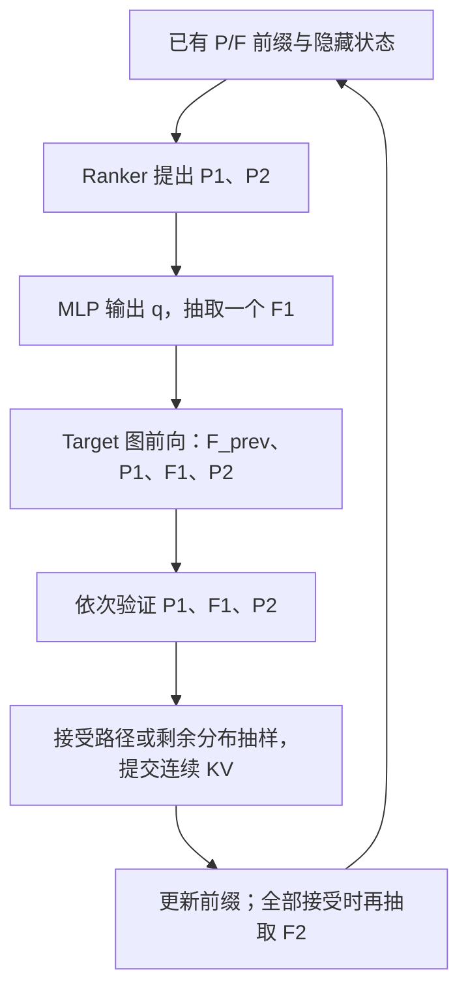

# Ranker+MLP W1 单分支图执行方案：4.966× 实测说明

后续已对同一实现完成 42 次端到端实测：相同 512-token 工作量为 4.334555×，另三个场景自然结束完整输出为 4.869038×；后者包含输出长度差异。VQ、渲染与保存的范围和分项见 [端到端结果](../w1_e2e_20261021/RESULTS.md)。下文 4.966× 仍指原 token 生成测量。

该方案沿用已有 Position Ranker、Feature MLP 和 Target 权重，通过结构化投机解码减少 Target 调用，再用 CUDA Graph、显式 BMM 注意力、按 token 类型计算输出头、批量 RoPE 和连续 KV 提交降低执行成本。在本轮 3 个开发场景上，相对原始 Target 的来源等权几何平均加速比为 **4.966189×**，95% 来源区间为 **4.533752–5.296830×**。

建议名称为 **Ranker+MLP W1 单分支图执行方案**。`W1` 表示每轮只提出一个 Feature 候选分支；常规一轮仍会提出 P1、F1、P2 三个候选，接受后再由 Target 抽取 F2，最多生成四个新 token。当前实现名为 `tree_w1`，宽度为 1 时树退化为一条线性路径。

## 1. 输入、模型和产出

GaussianGPT 的稀疏序列按 `Position, Feature` 交替排列。Position 指定空间位置，Feature 表示该位置的离散特征。输入是一个已有真实场景前缀，输出是后续 P/F token；本次速度测量到 token 解码结束，VQ 解码和三维渲染不在计时范围内。

| 对象 | 实际使用内容 |
|---|---|
| Target | 现有 `checkpoints/gpt_vfront.ckpt`，FP32 推理 |
| VQ 权重 | 原加载链路使用 `checkpoints/vqvae_vfront.ckpt`；本轮没有计时或重测 VQ 重建 |
| Position 提案 | `FastHistRanker`，根据已有 Position 状态选择 P1、P2 |
| Feature 提案 | 现有 step12000 MLP，输入为前一 Position 的 pre-finalnorm 隐藏状态、前一 Feature、候选 P1；输出完整 4096 类分布 q |
| 采样设置 | Target 与 MLP 均使用 temperature=0.9、top-p=0.9 |

“12k MLP”中的 12k 指训练更新步数。该版本没有新增训练，也没有扩大 Feature MLP。

远端主工程为 `/root/workspace/GaussianGPT`。MLP 权重为 `draft_a/runs/feature_target_continue_20261014/selected.pt`；Ranker 为 `profiling/target_eval/results/ranker_holdout_81001_81016/ranker_trained_on_61001_61016.joblib`。这些路径相对于主工程；加载入口见 [method_adapters.py](../../../../patches/feature_tree_20261021/reference/method_adapters.py)。

## 2. 一轮如何生成

一轮开始时，末尾 Feature `F_prev` 尚未送入 Target KV，缓存停在它之前的 Position。解码器保留该 Position 的隐藏状态，供 MLP 使用。

Target 的四行输出分别给出 P1、F1、P2、F2 所需的条件概率。验证按序进行，前一个候选被拒绝后，后续候选不再作为本轮已接受结果。

Position 是点提案：提出的 P 以 Target 概率 p(P) 接受；拒绝后移除该点并从剩余 Position 概率抽样。Feature 使用随机提案 q：F1 以 `min(1, p(F1)/q(F1))` 接受，拒绝后从 `normalize(max(p-q, 0))` 抽样。这里 p、q 都是采用本轮温度与 top-p 处理后的分布。

| 验证结果 | 继续方式 |
|---|---|
| P1 被拒绝 | 保留已处理的 F_prev，从剩余 Position 分布抽取真实 P1，再由 Target 生成对应 Feature |
| P1 接受、F1 拒绝 | 保留 F_prev、P1，从 Feature 剩余分布抽样，本轮通常生成两个新 token |
| P1、F1 接受，P2 拒绝 | 保留 F_prev、P1、F1，抽取真实 P2，再由 Target 生成其 Feature |
| 三个候选全部接受 | 保留四个已处理节点，直接由第四行 Target 概率抽取 F2，本轮生成四个新 token |

EOS 按 Position 事件处理；剩余预算不足四个 token 或无法提出 P2 时使用较短路径。上述接受与剩余分布规则在精确算术下保持 Target 的采样分布；浮点执行的一致性范围见下文验证材料。

## 3. 完整加速由哪些部分组成

| 部分 | 实现方式与作用 |
|---|---|
| 结构化投机解码 | Ranker 提出 Position，轻量 MLP 提出 Feature，一次 Target 短块前向验证多个候选，减少 Target 调用次数 |
| Target CUDA Graph | 将可复用的短块前向捕获并重放，减少 Python 与算子启动成本；历史长度按读桶选择对应图 |
| 显式 BMM 注意力 | 用分组矩阵乘法、因果遮罩、softmax 和 V 乘法计算当前短块注意力，配合图重放使用 |
| 按类型计算输出头 | Position 行计算 Position 与 EOS 输出，Feature 行计算 4096 类 Feature 输出，随后应用对应约束 |
| MLP 提案图 | 捕获 MLP 神经网络前向；CPU Ranker、top-p、随机抽样、接受/拒绝和恢复调度由图外代码执行 |
| RoPE 准备 | 仅定位当前节点需要的 Position 坐标，统一批量计算旋转位置编码，减少重复历史处理与逐节点调用 |
| KV 管理 | 复用容量为 1024 的缓存对象，每个请求重置状态；W1 接受路径始终连续，提交时省去分支 KV 搬运 |

这些部分共同构成 4.966× 对应的实际方案。既有图优化 MLP 已经采用 Target 图、BMM 和 MLP 提案图；W1 新执行版进一步调整 RoPE、路径提交和解码运行时。**W1 相对既有图优化 MLP 的同轮净提升为 5.47%**，当前没有逐项隔离实验来分配这 5.47% 中每个实现改动的贡献。

CUDA Graph 与 BMM 属于通用执行技术。可据本轮说明 GaussianGPT 的 P/F 条件链、提案、输出类型和缓存提交如何配合这些技术；现有数据尚不支持将 4.966× 全部归为投机算法本身的增益。本轮没有另列“仅优化执行的 Target”运行臂，也没有新的算法独立倍率。

## 4. 4.966× 的测量口径

实际记录为 [main_run02](main_run02/plan.json)：RTX 4090，PyTorch 2.8.0+cu129，FP32 highest，TF32 关闭，batch=1。3 个开发场景×64/256-token 前缀×seed 45101–45103，共 18 组输入；四个方法轮转执行，共 72 次，每次均生成完整 512 token。

| 方法 | 相对原 Target | 95% 来源区间 |
|---|---:|---:|
| 原始 Target | 1.000000× | — |
| 既有图优化 Ranker+MLP | 4.708736× | 4.322988–4.983163 |
| **W1 单分支图执行版** | **4.966189×** | **4.533752–5.296830** |
| W2 双分支版 | 4.769174× | 4.480462–5.056604 |

W1/既有图优化 MLP 为 **1.054675× [1.048754, 1.062945]**。W2/W1 为 0.960329×，因此当前选择 W1。

每条记录先用实际输出 token 数除以同步外层时长，再计算 W1/原 Target 的吞吐倍率。对同一来源的 log 倍率求均值，再对来源等权平均并取指数。95% 区间按来源重抽 10,000 次，seed 402101。这是 4.966189× 的定义。

作为另一种统计方式，18 次合并耗时为原 Target 130.699856 秒、W1 27.009839 秒；合并吞吐分别为 70.512702 和 341.208992 token/s。直接相除与来源等权几何平均采用不同权重，不应混用。

计时包含运行时创建、KV 分配与重置、首次建图、前缀计算、提案、验证、恢复、抽样和缓存维护。权重加载单列，未计入解码时长。每个方法有自己的持久运行时，预热对象另建后丢弃；因此主表保留首次建图成本，同时也体现后续请求复用图的收益。短冷请求不能直接套用 4.966×。

## 5. 调用数与正确性证据

三种方法各生成 9,216 token，原始记录汇总如下。

| 指标 | 原 Target | 既有图优化 MLP | W1 |
|---|---:|---:|---:|
| Target 调用 | 9234 | 3716 | 3716 |
| Target 输入 token，含前缀与恢复 | 12096 | 16901 | 16901 |
| MLP 提案调用 | 0 | 3436 | 3436 |
| Position 接受/实际验证 | — | 4361/4608 | 4361/4608 |
| Feature 接受/实际验证 | — | 1157/3237 | 1157/3237 |

投机验证会计算后来被拒绝的候选，因此 W1 处理的输入 token 多于原 Target；收益取决于减少调用、短块并行和图化执行的完整成本。W1 与既有图优化 MLP 的调用数、接受计数和每组同种子输出相同，支持“W1 新增收益来自执行路径”的判断。原 Target 与 W1 使用不同抽样调用顺序，不要求同种子逐 token 输出相同。

9 项采样律与 RNG 用例通过。最终数值验证在同一真实场景的两种前缀上覆盖 W1/W2、普通与图执行、KV 提交及恢复，共 1,742 项语义对照通过，最大概率 TV 为 1.15744e-6，支持集差异为 0。隐藏状态和 KV 使用全有限及相对误差要求；440 项逐元素 allclose 未通过仍保留，不能宣称任意输入上的逐位相同。

CPU 概率复算 12 项通过；两轮完整解码的来源倍率、区间、序列类型和 Position 递增均复算通过。每轮 W1 与既有 MLP 的 18/18 输出及共有业务计数相同，两轮四臂 72/72 输出和业务计数相同。详见 [数值范围](IMPLEMENTATION.md)、[概率复算](numeric_audit_run06.json)和[完整解码复算](independent_audit_run02.json)。

## 6. 源码位置与当前状态

| 文件 | 职责 |
|---|---|
| [evaluate_tree.py](../../../../patches/feature_tree_20261021/evaluate_tree.py) | 加载权重，选择 `tree_w1`，轮转测量各方法 |
| [tree_decoder.py](../../../../patches/feature_tree_20261021/tree_decoder.py) | `decode(..., width=1)`，提案、按序验证、恢复与输出 |
| [tree_sampling.py](../../../../patches/feature_tree_20261021/tree_sampling.py) | 接受概率与剩余分布抽样 |
| [tree_runtime.py](../../../../patches/feature_tree_20261021/tree_runtime.py) | 四节点验证图、RoPE、类型约束和连续 KV 提交 |
| [dynamic_target_graph.py](../../../../patches/feature_tree_20261021/reference/runtime/dynamic_target_graph.py) | 共用 Target trunk、短块图与 KV 缓存复用 |
| [mlp_medusa_graph.py](../../../../patches/feature_tree_20261021/mlp_medusa_graph.py) | 本方案使用其中的 MLP 前向图 |

远端已测源码为 `/root/autodl-tmp/gaussiangpt_feature_tree_20261021/source_run04/`，数据为同根目录的 `main_run02/`；`source_final_run05/` 另补审计入口和方法描述，推理模块保持相同。完整复现命令见 [执行状态](EXECUTION_STATUS.md)，既有矩阵无需重复运行。

当前证据覆盖 3 个开发场景的真实前缀续写、单卡和单请求解码。独立场景、完整自然 EOS、纯 BOS、长序列、其他 GPU、并发服务与三维质量尚无该 W1 版本的新结论。方案已完成原型实测，生产默认尚未替换。

本次整理只新增说明和文档入口，没有运行训练、GPU 测速或部署。
