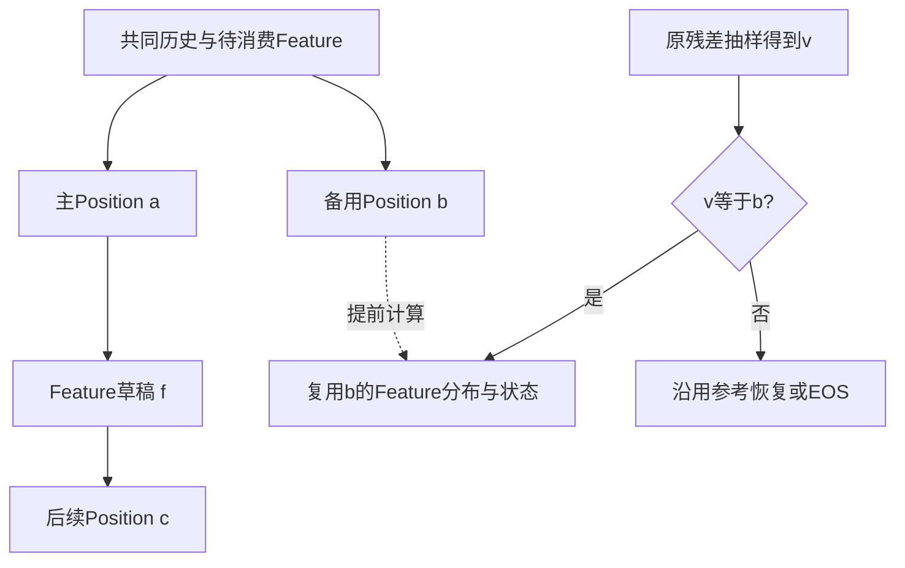

# GaussianGPT 算法论文大纲：从问题识别到理论与证据

2026-10-23。用途：后续论文写作的主入口。本轮完成文献研读、问题建模、算法与证明组织、章节级写作设计及证据对应；未启动新训练、GPU实验或部署。内容分为“当前已成立版本”和“需要新增算法与证据的研究版本”，两者不得合并成成果摘要。

## 0. 核心判断与阅读顺序

现有工作可以形成清楚、可复核的算法研究框架，但目前不能凭CUDA Graph、P/F分工、标准分布保持证明和单备用小幅收益认定已具备顶会算法创新。整体问题是：**异构条件生成中，给定廉价提案可读取的信息与有限验证预算，如何组织提高有效推进和减少恢复计算的两类操作？** 其中最接近现有新机制的子问题为：保持固定参考抽样过程，利用验证前已有信息选择值得预计算的恢复状态。GaussianGPT的Position/Feature交替生成提供具体实例，类型结构决定条件状态、提案输入与共享计算。

理论的任务是定义这一受限问题，准确说明合法策略、收益对象、可计算的选择规则、估计误差和适用边界。学术贡献仍要回答：这项限制为什么有用，最接近方法是否已经解决，新增机制是否在规定信息条件下兑现理论预测。速度属于验证维度之一；对效率算法而言，真实计算成本依然是问题定义的一部分，不能完全从评价中移除。

先读本纲第1–4节确定问题与区别，再读第5–7节的方法与理论，最后读第8–12节的实验、摘要和完成条件。[理论正文](THEORY_NOTES.md)、[通用投机正文研读](SD_PAPER_READING.md)、[mesh正文研读](MESH_PAPER_READING.md)、[补充论文研读](DOMAIN_PAPER_READING.md)、[独立理论审阅](THEORY_REVIEW.md)分别提供详细依据。


图中的新集合选择尚未实施；已运行实例为固定单备用。流程图表示论文论证关系，不表示全部研究已经得到正结果。

## 1. 论文中心问题：一句话、三项条件

### 1.1 整体问题与推荐子问题

整体研究分两层。第一层是提案：Position Ranker与Feature MLP在压缩历史信息下能够匹配哪些Target条件分布，如何把提案误差与有效推进联系起来？第二层是计算：在一个已确定的精确投机解码器上，哪些恢复状态值得提前计算？二者对应q和B两类不同决策，重训q会改变参考随机轨迹，选择B则可以保持轨迹。当前没有两者联合的全局最优算法。

给定一个精确的参考投机解码器和有限并行验证预算，**如何在不改变它的输出与接受路径的条件下，利用已支付的廉价提案信息，提前计算最有价值的恢复状态？**

条件一：参考抽样映射保持。主候选、真实提案q、残差抽样和随机数消耗顺序不变。新的动作只影响计算安排。这样可以逐路径归因，避免速度、输出内容和EOS变化同时出现。

条件二：决策信息有明确获取成本。本轮Target验证后才产生的概率不能用于决定同一次验证中已经加入的分支。需要另跑Target时，调用和等待进入成本。

条件三：收益按实际替代的条件计算衡量。分支覆盖了多少恢复概率质量、命中时能替代什么、额外验证成本多少，都必须定义。备选数量与接受率无法单独确定收益。

### 1.2 GaussianGPT为何是合适实例

序列是P1,F1,P2,F2,…。Position采用空间顺序约束下的Ranker点提案；Feature由轻量MLP给出完整4096类概率分布。正常W1验证输入是待消费F_prev、a、f、c。若主a拒绝，真实恢复位置v的Feature分布依赖(h,v)，需要额外Target前向。提前加入b分支可以覆盖这个依赖，而不必再提出b对应的Feature草稿。

这里的差异有具体计算含义：Position备选节点提供恢复后的Feature分布与hidden／KV；Feature提案支持继续推进主路径。类型名称本身不保证提案易学、不保证高接受率，也不代表新的条件独立性。

### 1.3 当前问题的可证伪形式

在相同参考状态与随机轨迹上，比较固定W1、固定备用集合和利用廉价信息选集合的策略。如果选择器没有在新来源上提高真实净收益，或成本细分与通用节点／进展目标产生完全相同动作，则新的选择主张未得到支持。允许结论保持为固定方法与理论分析，不继续把无效策略包装成贡献。

## 2. 如何识别文献仍未解决的内容

文献空白需要用范围限定、操作定义和对照证明。当前阅读足以确认大量重合，尚不足以证明一个全面的“别人没有解决”。推荐使用以下逐项比较，而不写抽象的统一不足。

| 比较维度 | 已有方法需要读取什么 | 我们当前操作 | 差异应如何验证 |
|---|---|---|---|
| 抽样选择 | 候选分布、Target验证概率、特定耦合或树验证规则 | 固定W1主路径与残差抽样，备用不参与新增接受 | 比较固定随机轨迹与同分布两种目标；不声称后者不足 |
| 候选产生 | 神经草稿、多头、检索或结构化提案 | 一次Ranker得出主与备用排序，MLP只提出主Feature | 同资源、同信息的提案器对照，排序信息消融 |
| 计算复用 | 通用树路径、候选成员命中、下一条件分布 | 复用(h,b)的Feature／hidden／KV | 与SpecTr和SpecInfer的等价实现比较，明确重合 |
| 预算目标 | 接受路径或生成量与验证成本 | 固定参考路径上的恢复成本节省减新增成本 | 对相同候选集合比较通用目标与恢复目标，避免给对方弱实现 |
| 决策时刻 | 各方法自己的树构造、Target读出时序 | 验证前选B，当前p不免费可用 | 记录信息获取调用与成本，分开oracle和可部署策略 |
| 运行状态 | 图、容量、缓存与硬件 | 已有图执行及非连续KV提交 | 冷态、暖态、长上下文和完整请求，禁止局部结论外推 |

**已确认的文献重合。** 标准残差抽样来自Leviathan等；候选树并行验证与精确采样来自SpecInfer等；成本与进展选树有Sequoia、OPT-Tree等；SpecTr §4已经说明最终样本位于候选集合时可复用下一条件分布；Drafter-Invariant已有固定随机输出相关理论。P/F展开可被普通状态转移模型表达。

**可继续研究的较窄区别。** 在固定参考解码器、廉价结构排序和验证前信息条件下，优化恢复条件状态的预计算。它是一项候选研究区别，尚未完成排除性文献结论。需要特别回答：保持参考路径是否只是人为限制，以及已有方法在同限制下是否能得到相同算法。

直接mesh工作必须进入相关工作主表。FlashMesh的结构化投机、XSpecMesh的多头草稿，以及mesh层级表示均需与本项目实际P/F状态区分；详细正文与会议身份以[MESH_PAPER_READING.md](MESH_PAPER_READING.md)为准。不得将“首次结构化三维投机解码”列为贡献。

### 2.1 最接近工作的原文级比较

| 工作与正文位置 | 已解决的具体问题与操作 | 本文的实际关系 | 尚需证明的区别 |
|---|---|---|---|
| SpecTr，NeurIPS 2023，§4–6 | 多候选有效耦合；最终样本属于候选时复用下一条件分布 | 恢复命中后复用与它直接重合；本文固定点提案及原残差抽样 | 固定参考限制的应用价值、同候选预算下的效率差异 |
| SpecInfer，ASPLOS 2024，§4.1–4.3 | 一次树注意力算各路径，共享前缀KV，递归随机验证 | 五节点状态计算属于其通用树操作的类型化实例 | 恢复语义能否带来额外选择价值，不能将树实现本身列为首创 |
| Sequoia，NeurIPS 2024，§3–4 | 接受率模型下动态规划选树；测t(n)、草稿成本再选规模 | 本文T3同样是受限候选与成本优化，数学工具有重合 | 恢复事件价值与推进代理是否导致可复现的不同动作 |
| OPT-Tree，TACL 2025，§3–4 | 用草稿路径概率作接受长度代理，输入依赖地贪心构树 | 廉价分数排序和数量选择有明确前例 | m_b是否可低成本预测、是否比代理量更准确地选出有效动作 |
| Traversal Verification，NeurIPS 2025，§3 | 叶到根的序列验证；有效性与单链期望接受最优性 | 本文不更换验证器，备用不参与新增接受 | 状态计算安排与验证器改变应分别比较，不主张同等最优性 |
| FlashMesh，CVPR 2026，§3.1–3.3 | Hourglass的face／point／coordinate层级；SP与HF模块；草稿顶点共享处理；backbone匹配验证 | 它已有结构化mesh投机；我们的Gaussian P/F不含同样面邻接关系 | 所读正文未给标准残差法的分布等价证明，但该性质本身已有通用研究；还须可比表示上的适配和质量证据 |
| XSpecMesh，arXiv v2，§4.1–4.3 | BPT多头cross-attention起草，p(x)>δ接受，头与LoRA分阶段训练 | 与我们的廉价多条件预测相邻；接受规则、权重更新范围不同 | 本文保留固定Target policy的精确算术性质；不能只靠性质标签证明新颖性或速度优势 |

FlashMesh的CVPR 2026身份已由CVF官方页确认；XSpecMesh本轮未取得可访问的录用记录，保持预印本身份。FlashMesh §3.3的“latest match”文字与首处不一致即停止的严格前缀规则未在所读正文中充分区分，本文不据此替作者补出精确抽样保证。两篇实测质量接近或改善，均不等同Target随机输出分布保持。

MeshGPT（CVPR 2024）的RQ面码与MeshAnything V2（ICCV 2025）的AMT序列压缩放在表示背景。它们说明结构可以缩短序列，但改变表示和缩短待生成序列，与本轮固定表示／固定参考输出的计算复用属于不同实验目标。mesh论文中的原生高效AR必须作为迁移时的实际参照，不能让原始低效实现承担全部算法收益。

## 3. 从代表论文学习的论证组织

这里学习的是公开论文如何建立可信论证；本轮没有匿名审稿意见，不能推断统一的审稿心理或录用原因。

### 3.1 SpecTr式：新问题 → 自然方案反例 → 有效算法

SpecTr先指出多候选直接重复接受会改变分布，再给最优传输定义、计算难点与有保证的近似方案。我们采用同样顺序：先明确增加候选可能改变抽样的风险，随后定义固定参考计算复用类，再证明哪些选择不会影响生成。T3–T4使用标准交换与扰动论证，不能声称达到SpecTr同等级的数学新颖性。

### 3.2 GSD式：真实诊断 → 对应理论量 → 机制与消融

GSD先展示视觉token的概率与总变差现象，再用分组总变差不增的简单定理支持设计，随后讨论动态聚类和质量。我们的诊断图应呈现P/F条件重合度、实际恢复事件与候选覆盖，不从低top-1直接推出高熵或不易预测。接受率理论、token级精确性、实际墙钟分开。GSD放宽精确抽样的路线不能直接移入本方法。

### 3.3 领域论文式：结构信息进入操作与消融

SpecMER的k-mer来自具体同源序列统计，错配先验对照帮助判断领域信息是否起作用。mesh论文的面／点／坐标层级也应看其实际网络与验证操作。我们的Position顺序、候选间隔、Target隐藏状态分别进入Ranker、MLP和恢复选择，必须有替换或移除信息的实验；给普通组件冠以“几何感知”不足以建立贡献。

### 3.4 应避免的写法

避免声称所有投机方法假设token独立、只能接受top-1、忽略恢复或没有成本建模。链式条件模型和多候选方法已有充分研究。避免用三维场景的视觉相似推导离散Feature可任意替换。避免把定理名称、模块缩写和复杂符号当作理论深度。每项主张都应有对象、限制、证明或反例、对应实验。

### 3.5 通用算法论文的具体论证对应

| 论文与身份 | 原文的关键组织 | 本文采用的具体写法 | 必须保持的边界 |
|---|---|---|---|
| Leviathan，ICML 2023 | Algorithm 1 → 分布保持 → 接受率／成本公式 → 不同任务实测 | 先定义参考抽样，再解释T1–T2与真实调用节省 | 独立同分布接受率的简化公式不能替代P/F条件事件 |
| SpecInfer，ASPLOS 2024 | 树构造／注意力／验证分开，§6.4–6.6分别做消融 | 条件历史、树节点、KV提交与抽样分别呈现 | 五节点树与共享KV有直接前例 |
| Sequoia，NeurIPS 2024 | 接受率模型与动态规划 → 验证性质 → 测得硬件成本选树 | 概率价值m与成本d分别定义，再验证受限选择模型 | 不把数量最优写成任意硬件或完整请求最优 |
| OPT-Tree，TACL 2025 | 路径概率代理 → 单调性 → 约8000步代理／真实量关系 → 实际吞吐 | 明确预测的是净恢复收益，并保留预测失效区域 | 代理相关性和理论性质不等于真实速度最优 |
| EAGLE，ICML 2024 | 特征与提前一步token输入 → 输入／树／batch消融 | 写明真实Z_F全部输入，用同资源移除输入的对照支撑类型提案 | 内部神经feature与Gaussian离散Feature不是同一个对象 |
| Traversal Verification，NeurIPS 2025 | 有效验证器定义 → 树正确性／单链最优性 → 规模／温度／吞吐 | 用明确策略类限定T1、T3、T5，分别评价输出、进展与成本 | 本文保持W1验证规则，没有新的树验证器最优性 |

原文出处与逐篇细节见[通用投机正文研读](SD_PAPER_READING.md)。Traversal的实际吞吐增量为约1.7%–4.8%的一组结果，仍配有明确的验证器定义与单链最优性证明；它说明增量大小与理论内容应分别判断，不能据此断言我们的微小增量也已具相同贡献。

### 3.6 mesh论文的呈现方式与本论文采用范围

FlashMesh把层级结构落到SP／HF输入与顶点共享操作，再通过模块消融和草稿数量消融回应机制。我们采用“真实P/F表示 → 实际提案输入 → 条件状态与恢复事件 → 分布／成本性质 → 对应消融”的结构，不能借用顶点重合解释Gaussian Feature。XSpecMesh把头数、阈值、head类型、LoRA分阶段训练分别消融；本文相应分离提案输入、备用集合、执行方式和有限精度，保持Target权重的配置变化需逐项说明。

MeshGPT先定义序列再解释编码长度，MeshAnything V2先给AMT规则再验证压缩比例。本文同样先定义token与完整请求工作量，随后使用速度表。现有512窗口和自然EOS结果不能合并成相同工作量的提速，Gaussian近似输出保持也不能替代绝对场景质量评价。

## 4. 贡献分层与候选标题

### 4.1 当前已成立版本

1. 在GaussianGPT的P/F生成链上实现类型条件提案与固定恢复分支预计算，保留参考W1的主提案与抽样操作。
2. 给出相对固定参考过程的轨迹保持条件、恢复命中测度和完整成本分解，并明确EOS、KV、随机流与有限精度边界。
3. 提供已有真实配对实验与负结果：输出与接受事件保持、恢复调用减少、扩宽成本和执行优化收益分开报告。

这些可以形成完整技术叙述；其中标准数学与常见执行技术不构成独立新颖性。现有多来源并不替代不同模型与表示的迁移。

### 4.2 更强研究版本：有条件纳入贡献

1. 明确并论证受限恢复预计算问题具有独立价值，与相近树／耦合方法形成操作层面的可验证区别。
2. 实施验证前的恢复集合选择，给出受限模型中的最优解和估计误差影响；在新来源上兑现选择预测。
3. 在另一自回归模型或表示上展示相同建模与机制，或用强可比方法证明类型信息带来的独立价值。

第2–3项尚未实施，不可写成“我们提出并证明且实测优于”的已完成贡献。若只添加一个普通收益排序器，仍需回答算法实质与已有决策工具有什么区别。

### 4.3 推荐标题

当前整体标题：**Typed Proposals and Recovery Precomputation for Autoregressive 3D Generation**。

中文：**自回归三维生成中的类型条件提案与恢复预计算**。

若最终正文主要贡献集中在固定恢复机制，可收窄为**Recovery Precomputation for Typed Speculative 3D Generation**。题目应跟随最终证据重心，不强行覆盖尚未证明的统一最优目标。

更强版本在集合选择有有效证据后可用：**Recovery-Aware Speculative Computation under Fixed Sampling Semantics**。

标题暂不使用Optimal、Universal、First或完整新框架缩写。typed表示输出有明确类型，不表示提出了新语法理论。3D范围符合现有实际任务；没有mesh实验时不把mesh写进题目。

## 5. 形式化模型：方法节之前必须定义清楚

### 5.1 模型、policy与状态

定义合法历史h、下一类型τ、Target最终policy p_h、Position点提案q_P=δ_a、Feature概率提案q_F，以及参考解码器Φ(s,ξ)。语义状态s包含完整历史、待消费Feature、逻辑KV、提案器状态、预算、随机流位置；运行时状态g保存图驻留和容量。FeatureStateDraft的压缩输入不宣称充分性。

说明p_h对应经过相同温度、合法性规则与top-p的分布。raw logits、部署policy、ranker分数使用不同符号。EOS只在规定类型与合法位置出现；没有备用或尾步时沿用参考路径。

整体设计目标可表述为在输出服从既定Target policy、可用计算访问与资源约束下最小化期望完成成本。提案θ与执行安排π都是设计变量；当前工作分别分析两个受限子问题，未求解一般联合最优。固定θ后合法恢复π的轨迹保持，比整体分布保持约束更强；更换θ时没有同种子轨迹保持保证。这一区别必须在问题定义处写出。

### 5.2 决策信息

选择器使用Z=ψ(s,g)，只包含已读取的廉价特征。历史可见且Target已知时，p_h由h决定；“没有计算p”是受限计算访问，不能写成信息论不可知。E[·|Z]仅针对明确压缩Z与状态分布μ成立。若另用Target评分选B，作为付费动作重新计成本。

### 5.3 压缩提案与有效推进

在EOS质量为零、预算充足且可提出主链的理想化正常轮中，令w=p_h(a)，P_s=p_h(F\mid h,a)，q只读取Feature压缩输入Z_F，则主P/F联合接受为w(1−TV(P_s,q))，E[R\mid s]=2+2w(1−TV)。该式不假设两个接受事件独立；真实policy含EOS时加入终止项，不能只筛掉观测EOS轮后套用。

固定外部状态分布μ，并按w重加权同Z_F的状态得到ν_z；给定z的最佳提案最小化E_ν TV(P_s,q)。若同z的两个独立状态的Target分布平均差异为D_z，则最小风险在D_z/2与D_z之间。这个标准统计推导把提案输入保留的信息与可能的推进收益关联，完整证明为T6–T7。

真实hidden是高维连续量，分箱数据不能直接证明原输入有这一不可约误差。现有MLP接受率、CE训练与平台期都不足以识别信息上限。按主位置概率加权TV训练属于拟议对照，尚无新增训练结果，也不能当作首次接受率训练。

### 5.4 动作、收益与目标

动作B为合法非EOS恢复位置集合，包含空集合。主路径保持。每候选的可替代成本定义为

\[
m_b(Z)=\mathbb E[\mathbf1_{H_b}c_{rec}\mid Z],
\qquad F(Z,B)=\sum_{b\in B}m_b(Z)-d(Z,B).
\]

H_b为真实参考恢复到b的事件，d为全部额外成本。完整请求目标是在相同参考输出条件下最小化E[T_π]。若g受动作影响，使用完整状态期望成本问题；仅在无跨轮影响的条件下简化为逐轮F最大化。

该模型把候选作用、可用信息、时间量纲和运行状态连起来。简单计数关系用于解释W1，不把pair单位变更当成新研究目标。

## 6. 算法节：现有实现与拟议选择明确分开

### 6.1 类型条件提案

Position Ranker一次predict_proba产生主与备用排序，候选集合由已有空间顺序规则给出。MLP从前一Position隐藏状态、前一Feature和候选a得到q_F，依真实q抽f。后续Position c是草稿状态上的近似，不宣称已知真实Feature或能跨越条件依赖。

需明确训练数据、Target教师、训练／开发／测试来源和已重复使用的数据。12k指训练更新步数，不是参数规模。现有Feature模块有2864384个可训练参数，完整输入与权重沿用[直接Target训练说明](../../FEATURE_TARGET_V2_2026-10-14.md)。

### 6.2 五节点恢复预计算

主W1四节点：[F_prev,a,f,c]。单备用加入b，共五节点；父索引[-1,0,1,2,0]，逻辑深度[0,1,2,3,1]。b只读取共同历史、F_prev和自身。主a拒绝时仍抽原残差位置v，若v=b就提交[0,4]，直接从b行Feature分布抽样并保存b行hidden；否则普通恢复。b不做第二次接受测试，不增加接受计数。



真实树注意力与KV路径另给小图。图索引只是实施信息，主文解释条件历史与共享计算，附录保存代码对应。

### 6.3 拟议算法：按预计净收益选择恢复集合

下述为研究设计，未实施。只在候选节点身份不改变额外成本、d只依赖数量k的模型中，按估计m_b降序；枚举k=0,…,K，最大化累计收益减d_k。集合选择不修改参考提案q和随机流。

```text
输入：参考状态s，运行状态g，既有主提案，合法候选C，数量上限K
1. 读取已支付的廉价特征Z；估计每个候选m_b与额外成本d_k。
2. 排序候选m_b，枚举全部合法k，包括不预计算。
3. 选择预计累计恢复收益减额外成本最大的集合B。
4. 运行原主验证路径并并行计算B的条件状态。
5. 完全沿用参考接受与残差抽样。
6. 实际恢复位置在B中则复用；其他情况沿用参考操作。
7. 提交真实KV与状态，丢弃未选分支。
```

固定单备用是选择步骤的一个预设动作，不证明估计模型或自适应策略有效。既有K1/W1/W2选择负结果必须引用，不能在相同开发数据上重述成成功策略。

### 6.4 实现细节位置

CUDA Graph、BMM、typed输出头、批量RoPE、图缓冲生命周期与KV移动放在实现节或附录。它们支持机制落地，不承担算法首要新颖性。所有可比算法共享同等执行优化；难以适配的官方方法须如实说明差异与训练资源。

## 7. 理论节：每个命题回答一个设计问题

完整证明见[THEORY_NOTES.md的2026-10-23节](THEORY_NOTES.md)。主文优先保留T1、T2，以及有诊断支持的提案分析和真正实施后的选择性质；通用数学推论可放附录，不以命题数量衡量论文深度。

| 理论项 | 对应问题 | 假设与结论 | 新颖性位置 |
|---|---|---|---|
| T1 轨迹保持 | 为什么提前计算不会改变生成？ | 精确条件状态、正确KV与原随机流 → 相对W1同输出同状态 | 当前机制正确性；已有通用复用与耦合思想 |
| T2 恢复测度 | 备用节点命中的量是什么？ | 点提案无条件恢复质量p_h(b)；一般固定q为[p−q]_+ | 标准残差法推论，用于定义收益 |
| 成本分解 | 多一个节点是否值得？ | 真实省时质量减完整额外成本 | 可复核解释；独立预测价值待测 |
| T3 集合最优 | 受限成本模型怎么选B？ | 数量成本、已知m → 排序并枚举k含0 | 标准交换论证；算法设计依据 |
| T4 误差影响 | 估计不准会损失多少？ | 统一收益与成本误差 → 选择损失≤2(ε+δ) | 标准扰动界；现实误差前提待建立 |
| T5 整请求 | 局部收益何时能累加？ | 相同轮次与未来成本状态、不受跨轮预算约束 | 受限可加结论；实际图状态例外 |
| T6–T7 压缩提案风险 | 廉价提案输入能支持多少推进？ | 固定状态分布、主概率加权 → 最佳TV匹配与条件差异上下界 | 标准统计工具；当前信息损失尚未实测识别 |

必须在正文给出的反例：相同主接受率却不同备用价值；相同廉价Z导致不可区分恢复状态；共享图成本使简单边际停止失败；未来图状态使局部选优失败。增加候选改变抽样概率的反例放采样依据处。

有限精度单列：logits／hidden／KV容差、支持集、BOS、图桶与输出路径。单行policy TV不等于完整转移核TV，有限样本重放一致不证明所有输入同分布。当前证明不会承诺任何GPU输入逐位一致。

## 8. 实验设计：围绕主张，复用已完成证据

### 8.1 现有证据能支持什么

| 主张 | 已有证据 | 支持范围与缺口 |
|---|---|---|
| 执行收益与投机收益分开 | 30来源、60输入、四配置240次 | 同轮3.240487×执行、1.557471×W1、1.016788×备用；不能都归为新算法 |
| 固定备用保持参考路径 | 同轮W1／备用60输出相同，388命中省388调用；另四次重复480配对 | 所测路径证据；不推出任意输入浮点精确 |
| 增加恢复覆盖不必提速 | 备用1–4，360次，新增命中342／53／9／0 | 完整计时含首图；支持固定少量选择，没有证明所有任务最优为1 |
| P/F不同计算角色 | W1源码、条件收益记录、接受与恢复计数 | 可说明角色；类型信息因果优势尚需强对照 |
| 成本细分不自动改善决策 | 10来源39状态，2808主测＋480分项 | 恢复模型与直接分别预测R/C动作39／39相同，未支持在线策略 |
| 输出产物保持 | 10来源20输入，60生成、60NPZ、360PNG | W1／备用tokens相同，Gaussian匹配近似一致，PNG少量差；不证明绝对质量提高 |
| 迁移至mesh或第二模型 | 无当前实测 | 只能作为计划，不能进入已完成贡献 |

数据路径：[贡献分解](../spec_next_20261022/PAPER_NEXT.md)、[备用数量](../position_widths_20261022/RESULTS.md)、[成本负结果](../recovery_model_20261021/RESULTS.md)、[条件收益](../feature_value_20261017/full/FEATURE_VALUE_REPORT.md)、[端到端](../w1_e2e_20261021/RESULTS.md)。先复用这些资料，当前无需重跑速度矩阵。

### 8.2 必要新增实验及失败含义

| 研究问题 | 最小实验 | 必须保留的对照 | 若结果不支持 |
|---|---|---|---|
| 问题限制是否有价值？ | 同候选集合、同验证预算比较固定参考恢复复用与可比树选择 | SpecTr／SpecInfer相应操作、相同信息成本 | 将恢复复用归为适配实例，不宣称新通用机制 |
| 廉价信息能决定恢复价值？ | 从新开发来源同状态重放合法B，记录实际省时与总成本 | 固定单备用、Ranker排序、概率覆盖、完整净收益 | 不实现或不宣传自适应选择 |
| T3模型近似是否合适？ | 改变候选身份而保持k，测完整成本差 | 直接配对净成本与仅数量成本 | 改用有限集合枚举或收窄模型，禁止声称精确硬件最优 |
| 选择机制是否兑现？ | 新来源完整请求，计入特征与选择成本 | 不加备用、固定1–4、通用可比选择 | 保留静态方法与负结果 |
| 类型信息有独立价值？ | 相同训练／推理资源，移除位置顺序或对应条件输入 | 统一草稿、Position-only、类型提案 | 收窄到特定配置有效，无类型普遍优势 |
| 提案信息与训练目标如何影响推进？ | 受控有限状态验证T6–T7；真实同成本输入与训练目标对照 | CE／已有TV／主概率加权TV，严格状态与数据使用 | 不宣称不可约上限或训练最优；保留条件分析 |
| 能否迁移？ | 第二模型或有可比条件依赖的mesh生成器 | 其原生高效AR与原生投机方法 | 维持Gaussian单模型范围 |

迁移若选择mesh，需要在同一backbone和表示上区分两种协议：精确抽样协议比较相同部署policy；经验质量协议比较CD／HD等质量与真实耗时。FlashMesh、XSpecMesh的原始接受规则不能直接放进精确协议并假定已满足相同分布约束。若通过新增残差法改写它们，应明确这是适配版本并同时保留原方法结果、训练资源与Target权重变化范围。

oracle上界只能使用明确额外Target读出或已测所有动作的信息，不能作为可部署方法速度。新开发资料与最终来源评价分开；旧30来源曾用于多次方法比较，不能称全新未见测试。后续实验需要独立授权与预算，本纲不自动启动。

### 8.3 图表与指标

图1：P/F条件链、主分支与恢复分支，不画新的几何独立关系。

图2：真实同前缀的类型条件重合度与恢复质量。仅凭现有分组只能展示关联，未识别因果的量不要画成结构导致。

图3：理论预测与完整配对成本差，含失败区域与不预计算动作。新策略尚无数据，当前只给设计，不绘制虚构点。

图4：备用覆盖质量与额外节点／首图成本，保留扩宽负结果。

表1：与最接近方法的信息、抽样、候选和目标差异；表2：同优化Target下效率与调用；表3：数值和输出保持；表4：类型与选择消融；附表：所有训练资源、数据使用、冷暖条件与端到端质量。

报告真实时间、Target调用、节点数与显存；质量与精确性分别评价。Gaussian绝对质量需要几何／渲染与真实场景评价，同W1结果近似一致仅支持复用保持。EOS结果含实际工作量差异，吞吐和请求时长分开。

## 9. 可直接展开的章节大纲

建议先写方法与理论，再回写引言与摘要。正文篇幅随会议模板调整，以下为约9页技术正文的分配建议，不表示任何特定会议的正式页数规定。

| 章节与篇幅 | 段落任务 | 必须出现的内容 | 读者应带走的结论 |
|---|---|---|---|
| 1 Introduction，约1页 | 应用价值→具体条件计算→已有方法→研究问题→贡献 | P/F拒绝后需要(h,v)状态；承认树复用前例；当前成果与新增策略分开 | 理解为何研究固定抽样下的恢复预计算 |
| 2 Related Work，约0.7页 | 精确抽样→树与成本→结构化／mesh→固定随机输出 | 原文级比较，FlashMesh／XSpecMesh单列，GSD质量路线区分 | 清楚我们继承什么、区别待证在哪里 |
| 3 Problem Formulation，约1.2页 | policy与状态→可用信息→合法动作→成本与目标 | Φ、Z、g、H_b、m、d、空集合，计算访问说明 | 问题可操作、可比较、没有免费信息 |
| 4 Method，约1.5页 | 类型提案→五节点→恢复复用→可选集合策略 | 真实q、注意力历史、KV提交、伪代码、EOS | 算法如何满足问题约束 |
| 5 Analysis，约1.5页 | T1→T2→成本→受限选择→误差与边界 | 简短证明与反例；标准工具归属；不主张通用最优 | 哪些结论成立，哪些条件不可省 |
| 6 Experiments，约2.4页 | 设计与数据→理论对应→主结果→消融→负结果→质量 | 同执行条件、完整成本、未见来源、迁移与有限精度 | 理论解释是否兑现、实用性是否成立 |
| 7 Limitations and Conclusion，约0.5页 | 适用范围→未解决点→精确总结 | 单模型、压缩特征、图状态、微小增量、无mesh迁移 | 结论准确且可扩展验证 |

附录A：参考抽样与W1正确性出处。附录B：T1状态与KV证明。附录C：T2–T5全部推导与反例。附录D：源码与图缓冲生命周期。附录E：训练配置、数据来源与所有样本计时。附录F：输出、BOS和数值失败项。附录G：负结果与未采用设计。

### 9.1 引言五段的写作内容

第一段：三维自回归序列的条件状态与生成需求，控制在实际Gaussian表示，不泛谈所有AI推理。

第二段：通用投机已能并行验证；在P/F例子中，主Position拒绝后的真实Feature仍依赖恢复位置，明确这一额外计算。

第三段：承认候选树与membership复用已有，提出保持参考抽样和廉价候选信息的受限选择问题，说明逐路径成本归因为何有用。

第四段：方法核心操作与理论性质，用一个恢复路径例子说明。CUDA Graph不在这一段承担创新。

第五段：只列真实完成贡献与证据。新增选择策略未经实验时不写入成果贡献；负结果可用一句话限定规模选择。

### 9.2 Related Work关键对比句的内容

“SpecTr优化多候选的有效抽样选择，并已利用候选成员命中复用条件分布。本文固定参考W1的抽样选择，研究合法恢复条件状态的预计算及其成本。”

这句话表达操作差异，不证明首创或更优。随后必须给相同条件下的比较或等价关系。对FlashMesh等直接mesh方法也需说明表示、原生层级、验证与是否保持Target policy，速度数字与这些方法条件分别比较。

FlashMesh一段先说明它的Hourglass层级、多模块预测与顶点共享处理；随后指出本文固定Gaussian表示、主提案与残差抽样，仅额外计算恢复条件状态。XSpecMesh一段明确cross-attention heads、概率阈值与LoRA训练；随后写本文的精确算术分布性质和固定权重范围。最后主动说明精确抽样与树状态复用都已有通用先例，区别仍需可比实验支持。

## 10. 摘要与贡献文字：只写当前有依据的版本

### 10.1 中文摘要工作稿

自回归三维生成通过交替的位置与离散特征token描述场景，两类token形成连续的条件依赖。我们研究廉价提案的信息与验证预算如何影响有效生成进展和恢复计算。首先将类型条件提案的联合接受与主位置概率加权的分布匹配联系起来，分析压缩输入下的条件风险。随后研究保持固定参考投机抽样过程的恢复预计算：利用已有位置排序，在主路径验证时计算少量合法恢复位置的条件状态，沿用原残差抽样，并在恢复位置命中时复用对应分布和缓存。我们给出精确算术下的轨迹保持条件，推导恢复事件的概率测度与净计算收益，并分析受限集合选择及估计误差的影响。GaussianGPT上的配对实验验证了所测输出与接受事件的保持及恢复调用减少，扩宽负结果展示了概率覆盖与真实计算成本的取舍。实现采用共享执行优化，并分别报告投机与执行收益。当前结论限于已测模型、来源和有限生成窗口；真实提案信息损失、自适应选择与跨表示迁移仍待验证。

工作稿包含理论分析但明确策略未实施。正式投稿若将T3–T4列为核心机制，需要先完成相应算法与证据；否则这些内容作为分析或附录，摘要相应收窄。

### 10.2 英文摘要工作稿

Autoregressive 3D generators interleave position and discrete feature tokens, creating conditional dependencies between geometric choices and subsequent feature generation. We study how inexpensive proposal information and verification budgets affect generation progress and recovery computation. We relate joint acceptance to position-weighted distribution matching and analyze conditional proposal risk under compressed inputs. We then study recovery precomputation under a fixed reference sampling procedure. Using an existing position ranking, our method evaluates a small set of legal recovery states alongside the main speculative path, retains the original residual sampler, and reuses a computed state when the sampled recovery position is covered. We establish trajectory-preservation conditions in exact arithmetic and characterize recovery-event mass and net computational benefit. We further analyze a restricted set-selection model and the effect of estimation error. Paired GaussianGPT experiments support output and acceptance-event preservation on the tested inputs and quantify avoided recovery evaluations; wider candidate sets illustrate the trade-off between coverage and execution cost. We report speculative gains separately from shared execution optimizations. Empirical identification of proposal information loss, adaptive selection, and transfer across representations remain open questions.

### 10.3 投稿前贡献句的限制

不要把最后一句的开放问题改成已完成实验。不要加入“首次结构感知”“新的残差采样”“全局最优”“零质量下降适用于任意浮点输入”。可以陈述明确前提下的精确算术性质与所测数值保持证据。

## 11. 常见审阅问题与需要的回答

| 审阅问题 | 当前诚实回答 | 最有价值的补充 |
|---|---|---|
| 这是否只是树验证的特例？ | 通用复用有前例，固定参考限制是当前问题范围 | 同候选等预算等信息对照、等价与差异证明 |
| 为什么一定保持同一随机输出？ | 有利于逐路径归因和复现；其应用价值尚未单独证明 | 真实复现／可替代计算需求，勿只人为设限 |
| 这些定理是否过于简单？ | 标准工具为机制提供准确条件，当前不宣称数学首创 | 新问题的必要性、非平凡机制或真实决策优势 |
| 选择器能提前获得p吗？ | 当前只能用Z；p作为诊断或训练标签 | 记录调用时序、压缩特征与付费oracle对照 |
| 类型语法怎样带来优势？ | 语法决定条件状态与输出头，提案性能仍属实测 | 同资源的类型信息消融和第二表示 |
| 单备用独立增量小吗？ | 解码有小幅增量，端到端尚不稳定 | 机制覆盖、成本边界与可推广范围；不夸大 |
| 理论能说明实际GPU吗？ | 受限成本模型需实测确认，图状态可破坏局部化 | 同状态不同集合的完整成本与冷暖结果 |
| 数据是否参与多轮选择？ | 既有来源多次使用，不能称全部首次留出 | 明确新开发和最终评价来源 |

## 12. 完成顺序与停止条件

本轮整理产物已能支持逐节写作。后续实施顺序为：最接近方法的同条件比较 → 新开发状态上的收益可识别性 → 最小集合选择器 → 未参与拟合的来源完整请求 → 第二模型或表示 → 正式摘要与投稿文本。每一步只在前一步支持时进入，不同时增加新草稿训练、动态树宽和表示变化。

若恢复收益无法从廉价信息稳定预测，保留固定单备用；若同限制下与既有树算法等价，贡献定位为结构化生成的适配与分析；若没有第二任务证据，题目保持3D／Gaussian范围。理论证明完善与文献阅读本身不会自动补足新颖性。

用户本轮要求的是学术整理与大纲，以上新增实验尚未执行。本轮不安排自动任务，不延续旧GPU预算，不操作远端。

## 13. 本轮数学复算与资料索引

主代理纯CPU精确有理数枚举：2000个点提案残差质量案例、100个数量成本集合最优案例、100个统一估计误差界案例均通过，固定随机种子231023。另以seed231024生成200组条件分布，验证13200个概率网格上的T7下界及200个均值上界，CE与TV目标差异反例为.32与.2。它们用于寻找代数反例，不是一般证明或新算法有效性的证据。[CPU记录](theory_cpu_20261023.json)保存结果与可复算输入规则。

本轮共14篇正文材料：六篇通用投机、两篇直接mesh投机、两篇相邻mesh表示、四篇补充论文；Drafter-Invariant使用正文HTML与指定PDF页，未逐页审阅全部PDF。文献笔记区分所读版本、发表身份、作者主张与性质限制。正文表格、本地引用、代码和数学分隔、JSON资料解析及受限用词均通过最终核对；公开检索没有穷尽近作，XSpecMesh录用身份仍未确认。

执行计划为[WORK_PLAN.md](WORK_PLAN.md)。历史研究故事与理论保留日期，新正式写作以本纲和THEORY_NOTES.md顶部2026-10-23节为准。旧速度、来源和未实施状态按原时间解释；不再以旧“执行协同”标题替代本轮问题建模。
