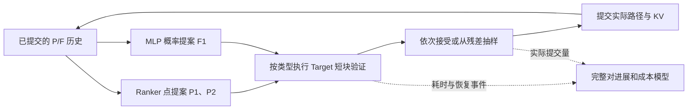

# 从 Ranker+MLP 到结构化生成的推理方法论文

## 2026-10-23 理论优先的正式写作入口

当前主文档为[算法论文大纲](PAPER_OUTLINE.md)。用户要求从顶会算法论文的角度重新组织问题、机制、理论与证据。本轮先列[执行计划](WORK_PLAN.md)，并研读通用投机、mesh与相邻结构化生成论文；详细笔记为[通用投机](SD_PAPER_READING.md)、[mesh](MESH_PAPER_READING.md)、[理论与其他领域](DOMAIN_PAPER_READING.md)，另有[独立理论审阅](THEORY_REVIEW.md)。

整体主线为类型条件提案与恢复预计算两层：压缩提案信息如何影响有效推进，以及固定参考抽样过程下，利用验证前已支付的信息选择值得预计算的恢复条件状态。两层对应q与B，当前没有联合全局最优算法。P/F结构提供实际条件链，CUDA Graph作为执行支撑。SpecTr等已包含候选成员命中后复用下一条件分布，通用树验证和成本选树也已有研究，当前不再把“结构化执行协同”本身写成首要新机制。

[理论正文](THEORY_NOTES.md)顶部新增完整状态、计算访问与压缩统计信息的区别、轨迹保持、恢复质量、成本分解、受限集合选择、估计误差、局部到整请求条件与反例。集合选择尚未实施；固定W1和单备用是已测实例。理论以标准数学工具推导明确性质，未据此宣称新的通用最优定理。纯CPU精确有理数枚举2000个残差质量、100个集合选择及100个误差界案例通过，仅作代数验证。

本轮完成学术整理与大纲，不等同已具顶会新颖性和全部证据。还需最接近方法的同条件差异、新来源选择验证与跨模型／表示材料。既有成本选择负结果、备用扩宽负结果与有限精度边界均保留。所有速度沿用原范围，没有新增GPU实验、训练、远端操作或运行代码改动；只整理静态文档，自动状态页保留原时间。下文按历史日期保留，不替代本轮大纲。

文献已交付：六篇通用投机、两篇直接mesh投机、两篇相邻mesh表示、四篇补充论文，共14篇正文材料。FlashMesh为CVPR 2026，XSpecMesh录用身份未确认；Drafter-Invariant补读所需HTML与选定PDF页，未逐页审阅全部PDF。大纲已纳入逐方法的操作重合与性质边界，特别保留匹配／阈值验证与标准残差抽样的区别。

## 2026-10-22 当前主线与实测更新

中心问题收敛为：Position/Feature交替生成中，以廉价候选覆盖原拒绝恢复的概率质量，在保持原W1抽样轨迹的条件下减少串行Target前向。方法采用类型条件提案、单备用恢复分支和与语法一致的执行组织；标准接受/残差抽样引用已有工作，备用分支不参与额外接受测试。正式算法、精确算术耦合证明、命中质量与局部成本条件已加入[理论正文](THEORY_NOTES.md)顶部。

原Target/同优化Target/W1/单备用同轮240次、30来源60配对完成。来源等权吞吐分解为`3.240487×执行 ×1.557471×W1 ×1.016788×备用复用=5.131692×`；单备用/同优化Target1.583618×。原/优化Target输出与计数60/60相同，W1/备用输出60/60相同，旧三配置180/180输出与counters相同。约5倍完整实现收益与约1.68%备用直接增量分别陈述。

当前单备用端到端补测10既有来源20输入、三配置60次完整保存Gaussian和六视图。全量备用/原Target请求时长比4.307862×，共同满512的19配对为4.185458×；备用/W1全量1.001848，95%区间[.962270,1.024833]，未显示稳定新增端到端收益。20/20输出token相同；VQ Gaussian行序变化，坐标一一对应后最大距离5.977205e-7，各字段相对L2不超过3.048302e-7。PNG有少量像素差异，最大变动通道比例0.00881619%；不声称逐位相同或绝对质量提高。

建议题目为`Recovery-Preserving Speculative Decoding for Typed Autoregressive Generation`。贡献依次为恢复分支复用算法、条件明确的轨迹与成本性质、可复现执行与同轮归因。备用2–4负结果用于说明边际质量和成本的取舍。当前单GPU/单模型/既有来源/固定512窗口的范围须在摘要与实验中保留；新自然全长、第二任务与完整场景质量尚未测。完整结果与运行位置见[本轮资料](../spec_next_20261022/PAPER_NEXT.md)。下文为历史设计，旧数字不替代本轮同条件结果。

**后续验证更新：** [同前缀成本实验](../recovery_model_20261021/RESULTS.md)已完成十来源2808行主测与480行诊断。恢复模型/W1局部进展率0.9875×，直接R/C模型1.0102×且来源区间含1，未支持在线预算选择，继续保留静态W1。[扩展相关工作比对](../recovery_model_20261021/NOVELTY_REVIEW.md)表明通用成本比值、学习式选树和状态奖励已有研究。下文保留最初设计逻辑，候选模块尚无有效新算法结果，不将其写成已成立的理论创新。

当前最有力的研究主线是：**利用异构 token 的生成语法，同时设计提案、恢复路径和设备执行，使实际提交的结构单元与真实计算成本匹配。**

建议题目：**Speculative 3D Generation through Typed Proposals and Execution Co-Design**。中文可用“类型化提案与执行协同的投机三维生成”。题目采用描述性名称，暂不主张新的通用树算法或新的编译器。

## 1. 论文的中心问题

GaussianGPT 把稀疏三维场景写成 Position/Feature 交替序列。二者约束、预测条件和提案成本不同：Position 有单调空间顺序，已有 Ranker 在所测条件下具有较高命中；Feature 使用 4096 类离散码，轻量 MLP 的接受率较低。后续 Position 的 Target 概率又依赖此前 Feature，因此高效生成需要处理整个条件链。

这引出一个具体问题：**在带有类型语法与恢复路径的生成过程中，应该把计算预算放在哪里，才能减少最终等待时间？**

接受率、更大的提案网络和更宽的候选树只描述部分收益。我们现有实验给出三条互相呼应的观察：阶段 E 的 PF-D8 Feature 接受率为 55.47%，轻量 MLP 为 33.26%，相对当轮 Target 的来源等权速度比分别为 1.466×、1.713×；W2 提高 Feature 命中、减少轮次，却增加每轮成本；执行优化显著降低 Target 成本后，提案和状态维护的相对开销变得更重要。前一项具体比较见[阶段 E 证据](../../PAPER_EVIDENCE.md)。

论文应围绕这些可重复观察展开，再给出能解释它们的理论与实现。用三四个具体机制承接同一个问题，方法自然会完整。

## 2. 当前方法的三个组成

| 方法组成 | 正式描述 | 现有实现 | 当前主张 |
|---|---|---|---|
| 类型条件提案 | 根据 P/F 的条件结构分配不同提案器 | Position 点提案 Ranker；Feature 概率提案 MLP | 异构提案可用同一残差抽样规则验证 |
| 完整对进展与恢复分析 | 区分候选接受、实际提交和额外恢复调用 | `P1,F1,P2` 验证，末端 F2 由 Target 抽取 | P1/F1 的联合接受决定正常轮次能否推进两对；P2 接受影响恢复成本 |
| 类型化验证执行 | 把语法、输出行类型与接受路径用于组织计算 | 按类型输出头、批量 RoPE、BMM、Target/MLP 图、连续 KV 提交 | 在既有模型与采样设置下减少执行开销 |

这张图中的生成链路已经实现。成本模型是本轮新增的分析表达，当前没有在线预算选择器。CPU Ranker、随机采样与 Python 控制仍在 CUDA Graph 外。W1 的验证路径为线性，不能将其称为新的树搜索。

## 3. 理论如何真正增加内容

### 3.1 异构提案的分布保持

将 Ranker 写为点分布 `q_P=δ_r`，将 MLP 写为条件分布 `q_F(·|φ(h),P1)`。二者都采用实际 q 与 Target p 的接受比及残差抽样。逐步证明条件分布保持，再通过条件概率链扩展到序列。

这给出统一的数学接口，解释为什么 Position 可以使用非神经 Ranker，Feature 可以使用轻量神经网络。残差抽样依据应归给已有工作；标准公式不能充当论文首要新定理。[Leviathan 等](https://arxiv.org/html/2211.17192)已经给出相应采样和速度分析。

### 3.2 将“接受长度”换成真实提交量与恢复成本

在无 EOS、预算充足的正常轮次，令 A1/AF/A2 表示 P1、Feature 和 P2 接受。当前解码器满足

\[
R=2+2\mathbf1_{A_1\cap A_F}.
\]

P1/F1 接受后，P2 接受或拒绝恢复都会完成 P2/F2。P2 接受影响额外 Target 调用，不能按同等权重解释为新增提交收益。

把成本写成

\[
c_w(s)=b_w(s)+\mathbb E[
\mathbf1_{\neg A_1}C_{\mathrm{rec},1}
+\mathbf1_{A_1\cap A_F\cap\neg A_2}C_{\mathrm{rec},2}\mid s,w].
\]

在不含 EOS 的局部模型中，宽度增加值得采用的条件为

\[
\Delta a>\frac{1+a_w}{c_w}\Delta c,
\qquad a_w=\Pr(A_1\cap A_F\mid s,w).
\]

EOS、预算边界、候选缺失和首次图创建应显式进入整体请求模型。局部阈值不提供全局最优保证。完整假设、证明与边界见 [理论草稿](THEORY_NOTES.md)。

这一分析目前最有研究价值的部分，是它与真实恢复策略直接对应，并有逐条计数支持。数学形式本身仍然简单；进一步贡献要来自可验证的预测或新的预算选择机制。

### 3.3 用负结果验证解释能力

W1/W2 各 18 条旧记录全部符合提交量和 Target 调用两条恒等式。W2 的每轮平均提交量增加 4.29%，完整外层平均每轮成本增加 10.06%，从而出现更多命中、较少轮次、总体更慢的结果。复算没有运行新 GPU 任务。

W1/W2 的生成轨迹不同，这些数值用于解释整批现象。证明局部模型能预测动作优劣，还需要同一前缀下的多动作重放与来源留出验证。[计数和代数记录](count_and_algebra_audit.json)保存本轮复算。

## 4. 可增加的一个方法模块

若希望论文进一步包含新的算法设计，我建议只增加**恢复感知的提案预算选择**，避免同时引入大草稿网络、多个新 Head 和复杂训练损失。

**状态输入。** 使用前缀长度、剩余预算、已有 Ranker 位置间隔、上一轮已经取得的类型统计、图与缓存是否就绪等低成本信息。当前 Target 尚未计算的熵、候选未来是否正确等信息不能免费加入输入。

**可选动作。** 从已有合法实现中选择，例如一对验证、W1、W2；W4 没有收益证据，暂不列为默认动作。不同动作必须各自遵守同一 Target 条件分布。

**预测目标。** 估计联合有效进展概率、EOS 事件和完整执行成本，选择预计 `E[R|s,a]/E[C|s,a]` 较高的动作。训练标签来自同一前缀、多动作的真实同步计时，包含图准备、KV 与恢复。不能把当前一次 W2 的高接受率直接作为动作标签。

**执行方式。** 在提案抽取前，根据已知状态选择动作；使用该动作真实提案分布完成验证。避免先观察多个候选、只保留有利候选，却继续使用原 q。

**成功标准。** 在未参与拟合和选择的来源上，预测能排序动作，并且包含选择器开销后稳定快于 W1。若只解释旧记录而不能兑现在线速度，应保留其成本分析价值，以静态 W1 作为方法结果。

后续已实现离线单轮探针与小型CPU线性模型，恢复事件成本与分别预测R/C在39个状态上选择完全相同，未取得稳定留源收益；在线模块未实现。它与已有硬件感知树选择存在明显联系，局部比值选择没有全局最优保证。当前保留为分析与负结果，详见上方完成报告。

## 5. 现有结果如何放进论文

| 拟写主张 | 可用结果 | 必须说明的范围 |
|---|---|---|
| 系统整体加速 | W1 相对原 Target 的 token 测量 4.966×；固定 512 token 端到端 4.335× | 两项来自不同轮次；均含执行与投机收益，只有三个来源 |
| 相同执行条件下的投机价值 | 历史 30 独立来源 PF/同优化 Target 1.443×；提案图轮 MLP/同优化 Target 1.489× | 使用各自同轮记录，当前 W1 没有新的同优化 Target 单独测量臂 |
| W1 的执行增量 | W1/既有图优化 MLP 1.054675×，输出与共有计数相同 | 5.47% 属于执行改进，三个开发来源，尚需独立确认 |
| 接受率与成本不等价 | W2 Feature 命中 35.74%→42.89%，W2/W1 0.960× | 两臂轨迹不同；需要同一前缀对照来验证局部预测 |
| 完整输出可运行 | 42 份 NPZ、252 张 PNG 有效；六次自然结束均成功 | 有效产物尚未证明视觉质量相同 |
| 自然结束等待时间 | 三对完整输出 4.869×，生成吞吐 3.560× | W1 token 总数少 31.35%，不能用 4.869×描述相同工作量 |

主速度图可以保留原 Target 作为分母，同时相邻展示同优化 Target 与各投机方法。这样既保留用户关心的完整收益，也回答执行改进贡献多少。只有同一轮、同一配对和同一聚合定义下，倍率分解才可直接对应；不能将旧轮次因素相乘解释新 W1。

## 6. 相关工作划分

| 已有工作 | 原文支持的已有内容 | 我们需要回答的差异 |
|---|---|---|
| [Leviathan 等](https://arxiv.org/html/2211.17192) | 分布保持的候选接受与残差抽样、速度分析 | 异构 P/F 的实际恢复和执行组织提供什么额外价值 |
| [SpecInfer](https://arxiv.org/html/2305.09781) | 随机候选树验证与并行验证系统 | 专用类型、完整对恢复与 KV 连续路径的独立收益 |
| [Sequoia](https://arxiv.org/html/2402.12374) | 期望 token 进展的树构造与实测验证时延优化 | 对恢复完成额外 token 的策略，通用树目标能否直接表示；差异是否带来可测收益 |
| [OPT-Tree](https://arxiv.org/html/2406.17276) | 按提案路径概率自适应提高接受长度 | 实际提交量和恢复耗时目标是否比接受长度更准确 |
| [EAGLE](https://arxiv.org/html/2401.15077) | 预测连续隐藏特征以支持提案 | 其连续 feature 与本项目离散 Feature token 含义不同；比较必须采用可比执行条件 |
| [Medusa](https://arxiv.org/html/2401.10774) | 多头候选与树注意力 | 异构廉价提案与统一神经提案的收益和开销如何变化 |

已读六篇相关正文段落，并未完成所有近作的全文比较。文献检索不能据此支持“首次”或“唯一”主张。尤其 Sequoia 已有硬件成本目标，单独提出“考虑成本”不构成清晰差异。当前潜在差异集中在完整 P/F 对进展、分支恢复和类型化设备执行如何共同决定预算。

现有 EAGLE/Medusa 数字来自本项目适配实现，图覆盖、训练数据和采样方式有各自范围。它们支持“所测配置的结果”，还不足以宣称全面优于官方方法或所有最强实现。

## 7. 三种投稿叙事

以下为基于现有材料的方向判断，不代表对个别审稿人的预测，也不涉及投稿日期。

| 方向 | 中心问题与建议题目 | 最关键的新增证据 |
|---|---|---|
| CVPR / ICCV / ECCV | 三维生成的结构语法如何支持低延迟推理。`Structure-Aware Speculative Decoding for Autoregressive 3D Generation` | 独立场景的几何/渲染质量、速度质量关系、另一三维模型或表示、完整生成表现 |
| ICLR / ICML / NeurIPS | 异构条件生成中，实际进展和恢复成本如何共同决定投机预算。`Recovery-Aware Speculation for Typed Autoregressive Generation` | 可迁移的建模、来源外成本预测、一个额外结构化任务、真实有效的新选择机制 |
| MLSys / ASPLOS | 类型与恢复路径如何驱动高效验证运行时。`Typed Speculative Execution for Structured Generative Models` | 同条件强对照、逐组件贡献、第二硬件、缓存与图创建成本、长序列和并发负载 |

我目前优先选择系统与推理方向，视觉方向需要补质量与三维迁移，通用机器学习方向需要补方法迁移和新的决策证据。这里三种叙事对应不同实验重心，不宜只更换论文标题。

官方资料支持这些研究范围：CVPR 列出高效视觉和三维研究；ICML 包含理论、系统与应用，要求主张由可重复实验或可靠理论支撑；MLSys 列出高效推理、运行时和硬件高效方法。[CVPR 范围](https://cvpr.thecvf.com/Conferences/2026/CallForPapers)、[ICML 要求](https://icml.cc/Conferences/2026/CallForPapers)、[MLSys 范围](https://mlsys.org/Conferences/2026/CallForPapers)。关于其他同组会议的建议属于研究定位判断，本文没有逐一评估其具体当届要求。

## 8. 最小补充实验与停止位置

1. **统一贡献分解。** 在新的来源上同轮运行原 Target、普通执行 W1、优化执行 Target、优化执行 W1；再单列提案图和 W1 执行增量。保留首次建图和运行时复用数据，比较相同 token 工作量与自然结束两种范围。历史四臂材料可作为起点，当前 W1 的新主表需要直接测量。
2. **预测模型验证。** 同一前缀重放少量现有动作，先验证提交与恢复模型能否在留出来源上预测耗时排序。若预测无效，停止增加在线选择器。
3. **质量与泛化。** 按投稿方向优先补三维质量和另一模型，或第二 GPU、长前缀与并发。只报告实际运行的设置，不把更多 seed 当成更多独立来源。
4. **新机制净收益。** 只有前两项支持时才实现预算选择，包含其状态提取和决策耗时，与静态 W1、固定 W2及可比成本树方法直接比较。没有净收益时保持 W1，保留 W2 负结果，不自动扩到 W4。

这些是最初设计阶段的建议；后续预测验证已完成，未支持在线选择，当前不继续该模块。本文摘要和主速度引用仍沿用原有实验范围。

## 9. 可直接改写的摘要草稿

自回归三维生成将空间位置与离散特征交替编码，两类 token 的约束、提案成本及恢复行为存在差异。我们研究这些差异如何影响投机解码的实际收益，并构建类型条件提案与验证执行协同的方法。该方法使用位置 Ranker 和轻量 Feature MLP，通过 Target 残差抽样保留参考过程的条件分布，并依据 token 类型组织输出读取、位置编码、图重放和 KV 提交。进一步，我们从实际恢复流程推导完整 P/F 对的提交量与成本关系，解释候选接受率提高而速度下降的现象。在所测 RTX 4090、FP32 设置中，方法相对原 Target 的 token 生成加速达到 4.966×；在三个来源、18 个相同 512-token 工作量的配对输入上，包含 VQ 解码、六视图渲染和文件保存的端到端加速为 4.335×。相同执行优化下的历史多场景比较显示投机部分仍有额外收益。结果表明，结构化生成的提案设计需要同时考虑类型条件、恢复成本与设备执行。更广的硬件、模型和视觉质量评价仍待完成。

摘要中的分布结论对应精确算术下的抽样性质，正文必须同时陈述有限精度范围。若后续预算选择有效，再增加其独立结果；当前摘要没有把它写成已完成机制。

## 10. 建议的论文结构

引言以三组矛盾进入：高接受率草稿更慢、W2 命中更多却更慢、单独 token 速度与完整等待不同。相关工作说明标准抽样和成本树已存在。方法先定义类型状态与异构提案，再给出提交量/恢复模型，最后写实际运行时。实验先给同条件贡献分解和端到端主表，再做模型预测、组件和质量/硬件分析。结论保留单模型、FP32、batch=1与有限来源限制。

建议主图依次为：P/F 条件链与真实恢复路径；实际提交量/每轮成本的二维比较；原 Target、优化 Target、优化 W1 的贡献分解；端到端阶段时间。预测与质量尚无数据的图仅作为待做图，不绘制虚构曲线。

## 本轮产物与资料路径

新增本文、[理论草稿](THEORY_NOTES.md)和[CPU 计数/代数复算](count_and_algebra_audit.json)。既有数值引用 [W1 说明](../feature_tree_20261021/W1_SOLUTION.md)、[W2 结果](../feature_tree_20261021/RESULTS.md)与[端到端结果](../w1_e2e_20261021/RESULTS.md)。本轮没有修改推理源码、权重或生产设置，没有新加速实测。

最初设计阶段同步的项目资料为 `.codex/AI_START_HERE.md`、`docs/project/RESEARCH_SOLUTIONS.md`、`docs/project/PAPER_EVIDENCE.md` 与自动生成的 `docs/project/PROJECT_STATUS.md`。该阶段三名既有 Luna/max 分别完成理论、投稿定位与文献比对；理论与计数经再次独立审阅，当时未启动远端任务或 GPU 工作。后续实际实验及其边界以本文开头链接的完成报告为准。

研究路径为 research-router → academic-local → academic-evidence；[检索记录](/Users/lief/.codex/skills/research-router/records/routes/2026-10-21/gaussiangpt-ranker-w1-literature-20261021.json)保存在 Skill 数据目录，原始文本位于 `/tmp/gaussiangpt_academic_raw_20261021/`。六篇论文有正文段落依据，较新多模态研究只完成发现，相关工作范围仍不完整。
