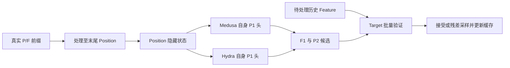

# A0：源码与状态核验

日期：2026-10-17。主工程：/root/workspace/GaussianGPT。新增实验：/root/autodl-tmp/gaussiangpt_round2_20261017。

## 结论

Medusa/Hydra 的 Position 由自身头产生。当前训练和在线均从最后一个 Position 的状态跨过历史 Feature 预测下一 Position，标签偏移相符。源码中“Feature 锚点”的部分注释与实际取样不同。低接受率不能仅归因于 Feature 网络形式。

## 数值证据

- 位置 ID 与 rank 完全一致：True；位置数 8000。
- 已测上下文中，最后块 RMS 归一化状态与 lm_head 输入最大绝对差为 0；两种状态输入 Hydra 后 q 的最大总变差为 0。
- 十个缓存/整段对照样本中，状态最大绝对差为 0.00026029348，Target 分布最大总变差为 0.00078464672。这些样本来自同一来源，不能替代全部缓存分支验证。
- 整段前向不会自动应用位置递增限制；计算离线 Target 分布时显式添加相同限制。首次遗漏该操作的诊断副本保存在 initial_unmasked_diagnostic，不用于正式统计。
- 现有验证循环使用提案时的完整 q、接受概率及正残差，并处理 P/F 类型、EOS 和缓存回退。本轮复用该循环；七条路径短生成另行验证。没有重新证明全部已有分支。

## 调用关系

## 资产

source_snapshot 保存实际运行源码；git_status.txt 和 git_diff.patch.gz 保存原工作区状态与差异。previous_evidence 含旧比较的逐条 JSON、训练记录及汇总。权重保留远端原路径，没有复制进文档包。

十个样本的已处理前缀、待处理 Feature、标签位置、草稿/Target top-5 和重合度见 A0_ten_samples.json。原训练代码、在线代码与行号对应见上一级路线评审文档。
